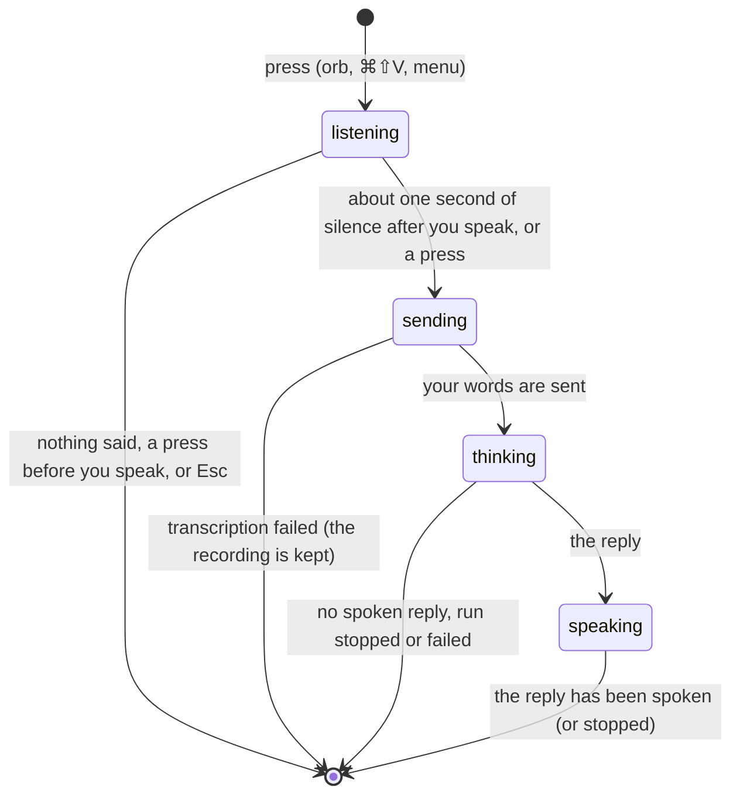

# Voice

Microphone capture and audio playback happen on your Mac; speech-to-text and text-to-speech run
on the gateway. The assistant offers three voice features: reading replies aloud, dictation and
voice questions (the voice conversation: one question per press of the orb). Dictation and voice questions need the `voice` extra for microphone
capture (`pip install "abstractassistant[voice]"`), and each feature needs a gateway that
advertises the matching voice route.

The voice control is the orb beside the composer: your activity avatar when it is turned on in
Settings → Appearance, a simple sound icon otherwise. "Listening", "Thinking" or "Speaking" appears
above it while that is happening; it shows nothing when idle. The orb sits on its own slightly
transparent panel, so it and its label stay readable over any window behind the palette. Click it
to ask a question by voice; click it while it listens to send what you said straight away; click it
while a reply is being read to stop reading. Right-click it for the other choices, each ticked while
it is on: **Voice conversation (⌘⇧V)** (ticked while a voice question is in progress);
**Dictate into the message box**; and **Read new replies aloud**.

Speech uses the gateway's default engines (its **Text To Speech** and **Speech To Text** routes,
`output.voice` and `input.voice`) unless you choose another provider and model for this app under
Settings → Models & reasoning (Voice output (TTS) / Voice input (STT)) — the one place the
engines are chosen; the Voice page has no engine card. Leaving an override empty always follows
the gateway's current default.

See [settings.md](settings.md) for the Voice page and [troubleshooting.md](troubleshooting.md)
for failures.

## Speak a reply

Every assistant reply has a speaker button. Click it to hear the reply; click again to pause and
resume. Switch on **Read new replies aloud** in the orb's right-click menu (**Speak replies
automatically** in the header toggle or Voice settings: the same preference) to have every final
answer spoken. Replies stream from the gateway's streaming TTS lane, so long answers start
playing within about a second; when the stream is unavailable the assistant says that it is
synthesizing the whole message first.

If the gateway's speech support could not be checked (for example while the gateway was starting),
pressing the speaker button checks again and then reads the reply, with no second click; Stop
cancels it while the check runs. When the gateway rejects a cloned or selected voice, the reply is
not read with another voice: press the speaker button to try the same voice again. Any other
failure before the first sound (the audio output, the network) keeps its own message, and the
whole reply is prepared again with the same voice.

Pausing keeps queued speech until you resume or stop it. With the matching AbstractVoice
player, five seconds without output progress triggers one attempt to reopen the output and
continue pending speech. Recovery leaves microphone capture running and shows a notice. If
the device still cannot play, a banner explains that part of the reply may be missing.
Audio already submitted to disconnected hardware can be lost.

Spoken text is prose: markdown, code, images and link targets are removed before synthesis, and
folder paths are read with "slash" between their parts and the signs ≥, ≤ and ≠ as words (in
English, whatever the reply's language). A reply with nothing left to read
says so instead of playing nothing.

## Dictate

Right-click the orb and choose **Dictate into the message box**. Speak; after about one second of
silence the gateway transcribes what you said and adds it to the message box, where you can edit it
and press Return to send. Click the orb again, press Esc or untick **Dictate into the message box** to
stop listening.

## Voice conversation: one question per press

Start with a click on the orb, ⌘⇧V, **Voice conversation** in the orb's right-click menu, or the
tray menu. Each press is one question, like the orb of the Apple Watch app:

1. **Listening**: speak your question. About one second of silence after you speak ends it. To
   send right away, click the orb. If you say nothing for about five seconds, or click the orb
   before speaking, it stops with "I didn't hear anything" and nothing is sent.
2. **Sending and thinking**: the microphone is closed; the gateway transcribes what you said and it
   is sent like a typed message.
3. **Speaking**: the reply is read aloud. Then the orb is idle again; the microphone stays closed
   until your next press.

Esc while the orb listens cancels the question: nothing is sent. Once your words have been sent,
Esc ends the voice question but not the run: its reply still arrives in the conversation and is
read aloud only if **Read new replies aloud** is on. During the reply, Esc stops the reading.

Behavior details:

- **Auto-send** (default on): what you said is sent as soon as it is transcribed. With auto-send
  off, the words land in the message box and Return sends them.
- **An unfinished draft** in the message box is kept: a voice question never sends it or replaces
  it. What you say is added to the draft, a notice says so, and Return sends it. The same happens
  while a previous reply is still finishing.
- **Spoken-style replies** (default on): each voice question carries an instruction to answer
  briefly, in natural spoken language, without markdown. The workflow's own system prompt is kept
  in front of it.
- **Questions and approvals** that appear while the orb is listening end that question without
  sending it, so nothing said near your screen is sent while you decide.
- **Typing** a message while the orb listens or speaks ends the voice question; the typed message
  is sent as usual.
- If the gateway cannot transcribe what you said, nothing is sent and the recording is kept:
  **Retry** sends the same recording again, **Discard** forgets it.
- Replies to a voice question are always read aloud; **Read new replies aloud** keeps its saved
  setting for typed messages.

Failures name their cause in a banner: a microphone that cannot start (macOS:
System Settings → Privacy & Security → Microphone), gateway speech input that is unavailable, a
reply that could not be spoken, or a run that failed.

## Audio output

Playback follows the Mac's current default output device, resolved each time a reply is spoken,
so switching to headphones or another speaker in macOS takes effect on the next reply. You can
instead pin a device under Settings → Voice → Output device (see [settings.md](settings.md)).
When a pinned device is not connected, replies play on the system default and a notice says so.
When the system output is muted or very low as speech starts, a notice says so. If the output device stops accepting audio mid-reply, playback is stopped and reported, and
the next reply reopens the device. While the microphone is live, the device list is not
refreshed, so a device change cannot interrupt capture.
