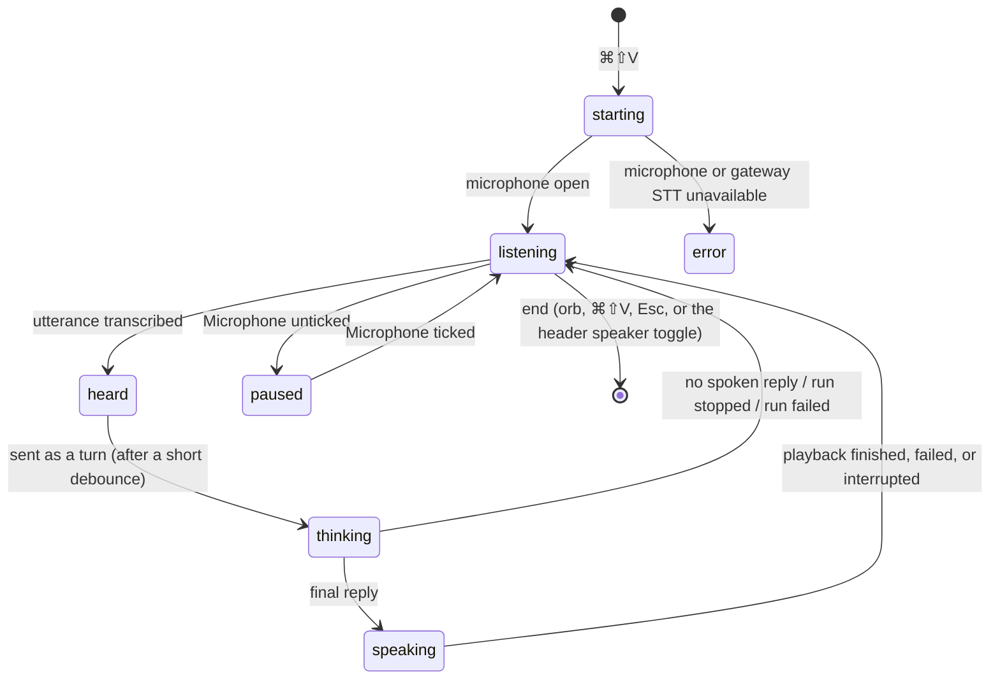

# Voice

Microphone capture and audio playback happen on your Mac; speech-to-text and text-to-speech run
on the gateway. The assistant offers three voice features: reading replies aloud, dictation and a
hands-free voice conversation. Dictation and conversations need the `voice` extra for microphone
capture (`pip install "abstractassistant[voice]"`), and each feature needs a gateway that
advertises the matching voice route.

The voice control is the orb beside the composer: your activity avatar when it is turned on in
Settings → Appearance, a simple sound icon otherwise. "Listening", "Thinking" or "Speaking" appears
above it while that is happening; it shows nothing when idle. Click it to start or end a voice
conversation; click it while a reply is being read to stop reading. Right-click it for the other
choices, each ticked while it is on: **Voice conversation (⌘⇧V)**; **Microphone** (during a
conversation: ticked while it listens; untick it to pause listening and tick it to listen again.
While the assistant works or speaks, the microphone is closed and the item is greyed out with the
reason); **Dictate into the message box**; and **Read new replies aloud**.

Speech uses the gateway's default engines (its **Text To Speech** and **Speech To Text** routes,
`output.voice` and `input.voice`) unless you choose another provider and model for this app under
Settings → Models & reasoning (Voice output (TTS) / Voice input (STT)) — the one place the
engines are chosen; the Voice page has no engine card. Leaving an override empty always follows
the gateway's current default.

See [settings.md](settings.md) for the Voice page and [troubleshooting.md](troubleshooting.md)
for failures.

## Speak a reply

Every assistant reply has a speaker button. Click it to hear the reply; click again to pause and
resume. Switch on **Read new replies aloud** in the orb's right-click menu (**Speak replies
automatically** in the header toggle or Voice settings: the same preference) to have every final
answer spoken. Replies stream from the gateway's streaming TTS lane, so long answers start
playing within about a second; when the stream is unavailable the assistant says that it is
synthesizing the whole message first.

If the gateway's speech support could not be checked (for example while the gateway was starting),
pressing the speaker button checks again and then reads the reply, with no second click; Stop
cancels it while the check runs. When the gateway rejects a cloned or selected voice, the reply is
not read with another voice: press the speaker button to try the same voice again.

Pausing keeps queued speech until you resume or stop it. With the matching AbstractVoice
player, five seconds without output progress triggers one attempt to reopen the output and
continue pending speech. Recovery leaves microphone capture running and shows a notice. If
the device still cannot play, a banner explains that part of the reply may be missing.
Audio already submitted to disconnected hardware can be lost.

Spoken text is prose: markdown, code, images and link targets are removed before synthesis, and
folder path separators and comparison signs are read as words. A reply with nothing left to read
says so instead of playing nothing.

## Dictate

Right-click the orb and choose **Dictate into the message box**. Speak; after about one second of
silence the gateway transcribes what you said and adds it to the message box, where you can edit it
and press Return to send. Click the orb again, press Esc or untick **Dictate into the message box** to
stop listening.

## Voice conversation (hands-free)

Start with a click on the orb, ⌘⇧V, **Voice conversation** in the orb's right-click menu, or the
tray menu. The loop:

What you see: the orb shows "Listening", "Thinking" or "Speaking" above it and moves with your
microphone level and with the reply's sound. To pause listening, untick **Microphone** in its right-click menu; the
composer's Stop button stops a run. The header title mirrors the state. An unfinished draft in the
message box is kept: the conversation does not send it or replace it.

Behavior details:

- **Auto-send** (default on): each utterance becomes a turn after about one second of silence;
  closely spaced utterances are merged. With auto-send off, words land in the message box and Return sends them.
- **While the assistant works**, speech is not transcribed (the microphone is paused) so side
  conversation never steers the run. Speech that arrives between the reply and the next listen is
  kept for the next turn.
- **Spoken-style replies** (default on): each request carries an instruction to answer briefly, in
  natural spoken language, without markdown. The workflow's own system prompt is kept in front of
  it.
- **Stopping a reply**: a spoken "stop" in barge-in mode returns the loop to listening. Esc or a
  click on the orb ends the whole conversation. Words heard while the previous run is still
  closing wait for the next listening window; they are never injected into the closing run.
- **Barge-in** depends on the Voice setting. "Pause the mic while the assistant speaks" (default,
  for speakers) never transcribes the assistant's own voice, so the reply cannot be interrupted by
  speaking; use Esc or the orb to end the conversation. "Keep the mic open" (for headphones) lets a
  spoken "stop" interrupt the reply.
- **Questions and approvals** pause the microphone while their window is open and resume it after
  your decision.
- **Typing still works** during a conversation; a typed send behaves like a spoken one.
- Auto-speak is on for the duration of the conversation and returns to your saved preference when
  it ends.

Failures name their cause in a banner: a microphone that cannot start (macOS:
System Settings → Privacy & Security → Microphone), gateway speech input that is unavailable, a
reply that could not be spoken (the loop resumes listening), or a run that failed.

## Audio output

Playback follows the Mac's current default output device, resolved each time a reply is spoken,
so switching to headphones or another speaker in macOS takes effect on the next reply. You can
instead pin a device under Settings → Voice → Output device (see [settings.md](settings.md)).
When a pinned device is not connected, replies play on the system default and a notice says so.
When the system output is muted or very low as speech starts, a notice says so. If the output device stops accepting audio mid-reply, playback is stopped and reported, and
the next reply reopens the device. While the microphone is live, the device list is not
refreshed, so a device change cannot interrupt capture.
