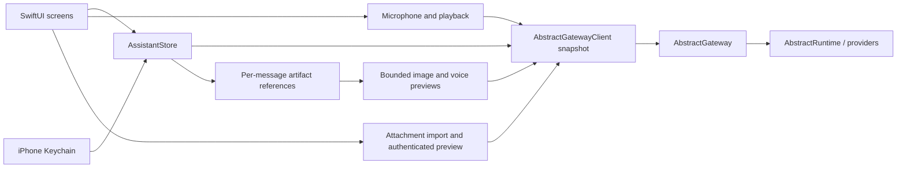

# iPhone architecture

`Sources/App` owns native views, Keychain access, recording and playback. The `AssistantKit`
Swift package owns account-scoped state and URL validation. Its second target,
`AbstractGatewayClient`, contains the HTTP wire types and protocol.

The gateway remains the source of truth for session history, workflows, tools, approval
policy, entities, model/voice defaults and automations. The app reads account preferences
before starting a turn, chooses the explicit catalog workflow when set, otherwise uses
`@default` with `abstractassistant.agent.v1`. A missing/broken choice fails visibly without
switching interfaces. The workflow picker writes only the account’s Assistant interface preference. Operator
defaults and other app preferences are never changed. Voice overrides, playback speed and read-aloud
preferences are stored locally, scoped by gateway/tenant/account.

The HTTP client uses an ephemeral URLSession, explicit bearer or session/CSRF headers,
and refuses redirects. A 401 locks the client out; the store removes the sign-in and stops
polling rather than repeatedly hitting the gateway’s failed-sign-in limit. Credentials are
Keychain items, with device-only accessibility, and are never encoded in a URL or passed
as launch arguments.

Store generations separate account changes and conversation changes. Old refreshes and
answers cannot repopulate a later account’s screen. Restoring a persisted session also
restores its visible history before sending is enabled. A failed/uncertain run-start POST
is never retried automatically: the user checks Conversations before resending.

Only a foreground task polls, with no overlapping refresh. Backgrounding stops the poll,
microphone and playback; it does not cancel a durable run. Stop is an explicit gateway
command. Stop intent is recorded before awaiting the start response, so a late run ID is
cancelled instead of abandoned. Root cancellation is sent once and the store follows the
run until its terminal state. Entity visits retry closure while the gateway holds its
writer lease. The square stays in its stopping state until confirmation; failures leave
a retry action and conversation recovery available. Completed stopped turns cannot trigger
automatic reading, and late send responses cannot restore the stopped visit. Tool approvals re-read the current run and wait key before sending a decision.

## Relationship to the Watch app

The initial client snapshot comes from `watch/apple/Packages/AbstractGatewayClient`.
`Packages/AssistantKit/WATCH_SNAPSHOT.json` records the source-file hashes. This isolates
the phone from ongoing Watch edits and avoids changing the Watch’s package or builds.
Phone changes add account workflow preference resolution and selection, artifact upload
and authenticated downloads, the Assistant interface/persona,
HTTP diagnostics and phone-oriented demo prose. Credential persistence and UI are entirely
separate. A shared package can be extracted after both clients’ APIs settle.

## Voice lifecycle

`VoiceTurn` is a local policy: authorizing → recording ↔ countdown → ready → transcribing.
Only `claimForTranscription` permits a network handoff, once. A tap activates capture.
`SpeechActivity` applies an adaptive raw-power gate with onset/offset hysteresis; confirmed
speech requires 180 ms of observed activity. Three quiet seconds after speech permit the
handoff. Resumed speech is processed before expiry and resets the quiet window. Recording
continues during the countdown, so a second phrase stays in the same local WAV. Initial
quiet/brief impulses never start a message; eight seconds without confirmed speech and
60 seconds of total capture discard locally. The hard duration limit wins over commit.

Touch-down while capture is pending cancels synchronously, even if the finger lifts after
the old deadline. No upload/STT happens before ready. Unknown meter values and sample gaps
over 250 ms reset the quiet/onset window; unobserved time is never inferred as silence.
Camera/navigation/account/session/background/audio-interruption paths cancel pending voice.
Permission completion checks current UIApplication state and generation before recording;
it briefly waits for prompt dismissal to activate the app and otherwise requires a new tap.
A voice turn sends separately from any typed draft, with currently staged attachments.

`VoiceController` owns recorder/player lifetime and temporary-file cleanup. Chat owns the
cancelable transcription task. A main-actor Task samples every 33 ms independently of run
loop modes. Raw power drives silence detection; two separate fast-attack display envelopes
drive the orb. `MicrophoneEnvelope` normalizes
recorder power against a recent peak and room floor with an 18 dB minimum span; short
syllables remain visible even when absolute microphone levels are much lower than mastered
playback. A low-variance window can update the visual baseline after 45 stable samples
without changing the raw speech decision. A perfectly sustained sound may therefore soften
visually. `AudioEnvelope` retains the playback soft knee for actual AVAudioPlayer power. Only the
small `VoicePresence` subtree observes the envelope. Continuous phase survives state changes;
voice rendering requests up to 60 Hz, working-state rendering up to 30 Hz; idle rendering is slower
and background rendering stops. The soft knee preserves differences
between loud syllables without saturating at ordinary playback levels. Energy changes
the ribbons’ curvature, spacing, rotation and stroke, independently of the raw silence gate. Reduce Motion freezes geometry
and rotation while retaining responsive light.

During a gateway turn, the same orb contour morphs into a rounded square with a stable
mint/lavender Stop glyph on a dark inset. One animatable progress value drives its contour,
ribbons, lighting and symbol outside the timeline renderer, with 0.65-second easing in both
directions. The illuminated rim and surrounding ribbons continue moving; working size is
96% of the sphere. The hit target stays 84 × 80 points.
The sole progress row belongs to the conversation. Touch-down consumes the Stop action,
so releasing after cancellation cannot activate the microphone. Repeated touches within
450 ms of cancellation are consumed. Reduce Motion keeps a static, recognizable square.

The composer uses separate floating + and keyboard buttons on the left and the orb on the
right, without a shared panel. The keyboard button cancels pending capture and expands
the editor into the available width while hiding the orb. A separate composing state
mounts the editor before requesting keyboard focus; its cancelable task checks that the
editor is still open before focusing. The field is removed while minimized, including
from accessibility. The keyboard button's accessibility value reports a preserved draft.
Outside taps dismiss editing and restore the floating controls. Only a small Listening
label sits above the
active orb; there is no visible voice Cancel/countdown or Done
button in chat. `OutsideInputDismissal` installs a screen-owned UIKit recognizer rather
than a window handler. It excludes text/caret/selection touches, allows simultaneous
recognition, never cancels the outside control's event and defers focus changes until that
action can finish. Leaving the screen detaches it.

`AssistantStore.completedReply` signals only a newly completed current turn. Automatic
reading listens for this event while active, rather than message-list refreshes, so restored
history and repeat polls remain silent. Entity speech retains its entity scope and voice.
Per-request provider/model/voice overrides follow the newer Watch client contracts.

## Voice settings and responder selection

The Watch's pick-and-preview flow is preserved: selecting a voice immediately requests a
short sample, and selecting a speed previews the current voice. Separate view-owned
controllers stop old previews when navigating, backgrounding or changing account; recorder/
player generations suppress obsolete completions. Speed is one of 1, 1.15, 1.3 or 1.5,
stored per gateway/account and applied locally through AVAudioPlayer.enableRate/rate before
playback. It applies to Assistant and entity speech while entity voice overrides remain
entity-owned. Invalid persisted speeds restore to 1. No speed is sent to TTS providers.

The labelled responder chooser sits below the chat toolbar. Its bounded width lets long names
truncate while retaining their full accessible value. Who answers lists Assistant and searchable
entities with explicit loading/error/retry. Entity discovery can load independently of the
store's run polling chain. Switching is blocked with a reason during an active run/import
or staged files; drafts are preserved.

The toolbar has three separate glass islands: Conversations, Share/Files/Tools, and Settings.
New conversation lives in Conversations, has a mint accent, and preserves the selected responder.
Sharing captures loaded user/assistant messages, their original media references, cached activity
and account/session identity at tap time. `ConversationExportBuilder` downloads explicit media
and files from confirmed write/edit records through existing artifact and workspace routes.
Unrelated workspace contents, notices, stats, runtime records and pending drafts are excluded.
Conversation voice recordings/read-aloud files are excluded; generated voice remains shareable.
Workspace bytes reflect the current saved file rather than a historical revision. Files are
deduplicated by original name and content hash, with collision-safe local names. Missing files,
incomplete activity or the 100-file/200-MB limits fail the entire preparation with a retryable error.

`RichConversation` renders public Markdown into attributed text, self-contained HTML and flat
RTFD alternatives on one transcript provider. The first 12 image previews are downsampled and
bounded to 320 points, placed after their message text; original files have separate typed file
providers. Attributed message-body metadata supports rich Mail/Notes handoff; receiving apps
control final layout. A prepared-share lease keeps owned copies available until activity
completion/cancellation, then removes them. Context checks before and after awaits prevent stale
exports and old unauthorized responses from affecting a newer account. Sharing is disabled for
empty/loading history or an active run. Per-answer Copy and speech controls remain; conversation
sharing owns the navbar action. Existing attachment/import navigation guards remain in place.

Entity creation uses the existing principal-scoped gateway endpoints. A cancelable name
check calls POST /entities/{slug}/validate before enabling the explicit Create action; the
same trimmed name and default-framework body then goes to POST /entities. The form discloses
permanence before mutation. No local model, spark or administrator permissions are invented.
Creation decodes manifest.slug/name, created and all warnings, including skills/capability
setup warnings. Partial/existing outcomes remain visible with an Open conversation action,
rather than inviting another creation. Account generations reject obsolete completions.

## Files and automations

Uploads are stored by `POST /attachments/upload` with the current session ID. Returned
`$artifact` plus `run_id` references are carried in both input attachments and the agent’s
context/media fields, matching the tray. Session artifact listing includes files from child
runs; the owner from each artifact is used for its download. IDs are validated before
constructing a gateway route. Size checks cap imports and streamed downloads at 25 MB.
Only app-owned local files reach QuickLook. Dismissing or replacing the preview removes
its local copy; account/session changes also remove preview data. Imports, recordings and
previews and export copies live under `tmp/AbstractAssistant/{imports,voice,previews,exports}`, in separate operation
directories. Upload completion/failure/cancellation and transcription completion/cancellation
discard their owned copies. Startup clears that temporary namespace and strict UUID-named
legacy copies left by interrupted processes; originals and Documents are outside its scope.
Creation and deletion reject namespace symlinks that could lead outside owned directories.
Picker origin and task generations prevent stale files crossing accounts or conversations.

Automation creation shares the Watch’s NewAutomation schema, eligible-workflow endpoint,
input-schema preflight and schedule@2 presets. Per-tool choices use a durable named snapshot. Daily clock
times follow the account time zone reported by the gateway. A pending creation retains its
request ID across retries, preventing uncertain responses from duplicating routines. The
creation response is retained for navigation even if refreshing the list fails. Shared
catalog workflows unsupported by automations v1 remain a gateway validation error.

## Conversation tool scope and metrics

`ConversationTools` is an explicit whitelist with Off, Auto and Approve modes. Assistant
turns carry the same enabled names in `input_data.tools` and `_runtime.allowed_tools`,
plus named `auto_approve_tools` and `require_approval_tools` in `_runtime.tool_policy`.
An empty list denies every tool. Inherited selection resolves enabled names from fresh gateway
discovery on every Assistant send, matching the desktop client; it is independent of the selected
workflow's Tools-pin defaults. The approval policy remains omitted when inheriting, leaving
approval decisions to the gateway. Explicit choices are intersected with current availability,
including their named approval lists. Discovery errors prevent run creation. Attachments and
policy travel in the same start request. This is the established desktop Assistant contract;
no additional tool-policy capability endpoint is required. Preferences use gateway/account,
responder and session keys. A compatibility client cannot silently discard an explicit policy.

Entity discovery uses `GET /entities/{name}/session-tools`. When its `visit_routes` field
is true, managed sessions open with the policy through the existing `visit/open` route,
then end through `visit/{run_id}/close` with `closed_by: pause`. The policy is installed
before the first tick. Gateways serving this inventory without `visit_routes` use the
compatible `/sessions` and `/end` aliases. Entity policy/state/decision routes remain
owner-bound. An approval is a persisted runtime wait; only its
exact key and a strict boolean decision are sent. The server executes through the entity's
own handler and rechecks its grant. Policy changes are accepted only between turns.
The phone reuses its session/visit IDs after reconnect, while generations prevent late
responses from crossing accounts or conversations. Legacy chat is used only when the
entity session-tool inventory is unavailable and no explicit policy was requested.

Message statistics are optional and answer-owned. Agent metrics fold the run's execution
subtree; elapsed time is the root wall span, not the sum of overlapping child durations.
Entity metrics cover only the latest completed turn between visitor-input parks, excluding
visitor idle time. Missing token usage remains unknown. Active streaming answers are not
cached as final measurements. Playback actions require both active playback and a matching
`readingID`, so only the spoken answer can expose Pause and Stop.

Automation history budgets are sent as `context.growing.max_tokens` only for growing
history with a custom positive value. Omission inherits the runtime default returned by
`GET /automations/defaults`. The budget is part of the creation retry fingerprint.

## Conversation tool categories

The phone preserves the gateway inventory’s `toolset`, risk tier and enabled/available
flags. Available categories sort first and use the accent color; unavailable categories follow
in muted styling. Tools within each category also sort available first, then by name. Search matches category, tool
name and description and reveals matching rows without changing saved disclosure choices.
Rows disabled by the gateway retain its explanation and cannot be enabled by a session
choice. Saving an explicit policy keeps those rows Off; gateway inheritance remains a
separate mode. Draft changes require Save and are scoped to the original account and
conversation. The search toolbar keeps Close and Save reachable while filtering.

For older entity inventories, exact-name discovery metadata can supplement a missing
category/risk classification. The entity’s availability and approval defaults remain its
own. Unknown categories remain Other. The phone adds no category-wide approval shortcut.

## Live conversation activity

`RunActivity` projects durable ledger records into model cycles, tool calls, public results,
waits and failures. Model messages, prompts and reasoning deltas are excluded. Runtime call
identities pair tool starts, approval resumes and results; cursors count consumed records
independently for each run. Retained detail is bounded to 250 rows and 4,000 characters per
result with visible truncation labels; counters include earlier events.

`AssistantStore` keeps the parent run as the owner of cancellation and final replies while
following its descendants for progress and person waits. Child sessions need not share the
parent's session ID. Listing rows are hydrated through run detail before presenting a
question or approval. The existing ledger SSE route provides live events, with polling on
404/405. Four simultaneous streams leave HTTP capacity for status reads; additional children
are polled. Reconnect resumes at the last applied cursor. Root completion drains all known
child ledgers, including children no longer referenced by an older gateway. Traversal stops
at 64 runs or depth 16 with an explicit coverage notice. Entity visits use their existing
scoped ledger endpoint, polling while the visit is active. Their wrapped records are
validated and adapted to the same projection.

Connection problems remain separate from run failures. Terminal failures and the activity
panel remain visible after refresh. Reopening a completed conversation loads its latest
turn's activity without reading conversation history aloud. Backgrounding cancels streams;
account and conversation changes invalidate pending responses.

**Approve** and **Deny** send the existing exact-key decision. **Approve all** is scoped to
the open conversation's currently enabled tool names, stored with its account, responder
and session preferences. It sends the same ordinary approval for the current batch and
uses named Auto policies for future turns. For an already running workflow, the client
answers later qualifying approval waits only while connected and active. Every tool in a
batch must still be available, covered by the grant and set to Auto; questions never qualify.
Manually saving Tools revokes the grant. The action is unavailable for unrelated Inbox
items, preventing a decision there from changing the open conversation's permissions.

## iPhone tool defaults and conversation overrides

The effective tool selection is the explicit conversation selection, then the iPhone default
for the connected gateway/account/responder, then gateway inheritance. `send` captures that
effective selection before dispatching either an Assistant request or an entity turn.
A saved empty selection remains an explicit deny-all value. Existing conversation keys
retain their meaning; app defaults use a separate namespace without session IDs.

The Tools editor maintains separate drafts for iPhone defaults and this conversation.
Changing any available mode creates an explicit override immediately. Save applies edited
defaults before edited conversation choices, while Close leaves persisted values alone.
The header's Tools control remains available during execution. Saving while a request is
running updates preferences for the next message and does not resend or mutate that request.
Gateway availability is still intersected with explicit tool choices at send time.

## Shared tool editor and automation grants

Settings defaults use a gateway/account key across responders. Existing Assistant defaults
migrate once; session keys retain their explicit overrides. The same editor is presented
in one context at a time: Settings, session, or automation. Session overrides win over
Settings; automation overrides independently win over Settings and never inherit the
currently open conversation's exception.

Creation snapshots fresh inventory with the selected automation override or Settings
fallback. `target.input_data.tools` and `_runtime.allowed_tools` carry identical enabled
names, including explicit `[]`. Named Auto and Approve lists belong to
`definition.policy.tool_policy`, compiled by AbstractRuntime at occurrence admission;
caller-provided `_runtime.tool_policy` is removed. Custom workflow inputs and model choices
are preserved. Gateway restrictions remain authoritative. This additive runtime contract
is required for mixed per-tool approvals; an older runtime's 422 is surfaced with choices
retained rather than retried without the policy.

The existing revise route acknowledges queued work. The client waits for the committed
revision, verifies the requested target and named policy, and rejects concurrent edits.
Run Now is guarded against repeated taps and never follows an unconfirmed policy save.
Existing definitions without a tool grant resolve Settings before their first manual run;
scheduled definitions retain their saved grant until explicitly revised. Editing Settings
does not silently rewrite existing server automations.

## Restoring chat history

Run list rows are index summaries and may omit output. Session history follows all list
pages, deduplicates roots, and fetches every root's full run result and prompt, with at most
four concurrent turn hydrations. The history replacement is atomic and ordered oldest
first. Only recognized public response fields become assistant messages; reasoning and
internal child outputs are not replayed. Restoring a terminal run keeps diagnostics quiet
and does not trigger Read aloud. A failed hydration reports an error and preserves the
current conversation instead of showing a partial reconstruction as complete.

## Generated images and voice

`RunSummary.mediaArtifacts` reads structured workflow output references, including nested
`outputs` and typed image/audio aliases. It carries the artifact’s owning run, MIME type
and safe filename into the corresponding conversation message. Repeated references merge
without losing richer metadata. Model-provided URLs and prose are never treated as authenticated
download destinations.

Run input restoration reads the established `runs/{id}/input_data` route, preserving original
uploads as well as generated outputs. The next turn uses its freshly attached image first,
otherwise the latest image in that session. The orchestrator receives `primary_image_artifact`
and `has_primary_image_context`, alongside the shared attachment/context fields used by desktop.
Changing sessions clears the source through ordinary message restoration.

`MessageMediaController` owns image thumbnails, Quick Look and independent generated-audio
playback. Downloads use authenticated artifact-content routes with redirect refusal and a
256 MB streaming limit. The disposable cache retains at most six files and 128 MB, excluding
a file actively open/playing or the newest single-file download. Context changes cancel
registered downloads and discard cached files. Each artifact has one conversation-owned transfer:
thumbnail and full-screen consumers await that task without cancelling one another when SwiftUI
rebuilds or removes a row. Images are decoded into the inline cache before consumers resume;
late preview presentation is guarded by the conversation generation. Missing temporary files are
refetched and genuine failures expose a retry. Audio pauses/stops per artifact and shares
microphone/read-aloud exclusion, interruption handling and measured orb animation.

Endpoint-backed image generation uses the gateway’s provider endpoint resolver in its Runtime
media host. The phone receives artifact references and reports public generation results;
provider endpoint credentials and profile resolution remain on the gateway.

## Session files and completed answer activity

The action row owns copy/speech and cycle/tool buttons per answer, plus positive-only
email/file/web source counters. Conversation sharing and the session file browser are available
from the toolbar; file source sheets also open the browser. Live/wait/error
activity retains its existing panel.
Terminal Assistant activity snapshots are keyed by root run ID. Older answers reconstruct
root/descendant ledgers independently; no latest-run state is attached to another answer.
Entity turns use their entity ledger and per-visit cursor boundaries. A restored entity
visit without a known boundary is labeled Visit activity rather than per-answer counts.

SessionFilesController combines paged session artifacts with existing authorized run
workspace metadata/list/content routes. It discovers roots and descendants, deduplicates
workspace roots, preserves relative directory paths, and fetches mutable file bytes anew
for each preview. It avoids admin host-file APIs. Bound account/session operations reject
late refresh/download results; cancellations delete owned partial/local files. Downloads
share the authenticated streaming size limit, redirect refusal and 401 lockout.

The artifact classifier retains logical paths, semantic type, producer and source refs.
Explicit voice_playback metadata and reserved dictation paths identify conversational
files. Legacy inference requires successful full session input/output hydration (four
concurrent reads, at most 64 turns) and preserves explicit user/AI file references. Older
ask.wav is inferred only through a same-owner session-memory source_audio link from an
audio.transcribe transcript to an uploaded client:ask.wav attachment. Older unreferenced
voice/tts artifacts from llm_call are inferred read-aloud files. The toggle discloses
inference; history failure retains ambiguous files. All paging is reversible display
filtering; no remote artifacts or originals are modified. Partial counts use + or an
unknown indicator, and ignored offset pagination is refused rather than looping.

Markdown/text previews render locally without executing embedded HTML. They read at most
1 MiB and display at most 200,000 characters with an explicit truncation note; Share uses
the complete local download. Image zoom and native audio/document preview remain available.

### Read and sent email collections

`RunActivity` projects confirmed `send_email`/`reply_email` tool results into `SentEmail`.
It joins results by runtime identity (or an unambiguous legacy match), requires explicit
inner success plus a message ID or accepted recipients, and deduplicates message IDs.
Only a whitelist of mail fields is retained from arguments; headers/credentials are not
copied. Bodies stay outside the generic 4,000-character activity summary. Existing
per-answer replay/snapshot/account-reset ownership also owns receipts; no mail endpoint
or mailbox reads are introduced. `EmailActivityView` shows separate read/sent searchable collections from directional
envelope counts, with compact rows and individual detail navigation. Message body rendering is plain text; HTML is optional source, never active content.

The latest 100 receipts are retained with a cumulative count and a visible limit notice.
Each text/HTML body is capped at 50,000 characters with an explicit truncation marker.
Send time comes from the completed ledger record and is not a delivery timestamp. Missing
fields and refused recipients are explicit. Read-only physical verification replays the
saved conversation and exports completeness/counts only, never the emails themselves.

`ReadEmail` projects successful `read_email` results; listing/search tools do not count.
Identity uses account + mailbox + UIDVALIDITY + UID (message ID only when no UID exists),
so replay/repeated reads do not inflate the count, and mailbox/UID namespace collisions
stay distinct. A later full-body read improves a headers-only receipt without a second
count. The action timestamp and original message Date header remain distinct; `body_skipped`
is surfaced as headers only. `RunActivity` retains the latest 100 read messages with a
cumulative count and visible limit; bodies/HTML share the 50,000-character display cap.

Each optional direction appears only for a positive confirmed count. The answer action strip scrolls horizontally if large text/counts need
more space. No mail is read or sent to populate these views: they replay authorized ledger
results, preserving existing answer/account/session ownership.

### Condensed file and web source receipts

`RunActivity.access` projects eight recognized Core tool contracts using `AccessActivity`:
read_file/skim_files, write_file/edit_file, web_search/skim_websearch, skim_url/fetch_url.
File headers/success prefixes and structured web success are required in addition to
outer execution state. Per-file skim errors, HTTP403 textual skims, edit previews/no-ops
are excluded. Skim URL metadata is parsed only before Content-Type, so page text cannot
spoof redirects. Returned file paths define run-scoped source identity; requested aliases
are retained separately. Relative/absolute aliases with the same returned path group, but
separate child workspaces do not conflate. Mail, discovery lists, search hits and opaque
shell commands are never misclassified as file/page reads.

File counts are unique run-scoped sources per category; repeated actions retain distinct
runtime identities and modes under each source. Web searches count successful query
operations, including empty results; discovered links are not fetched pages. Pages group
returned URLs and preserve requested URLs, HTTP methods and skim/fetch modes. The receipt
projection retains only whitelisted path/query/mode fields, never write content, HTTP request
headers or request bodies. File excerpts/change receipts and web previews remain recorded
data; no file/site is automatically opened. User-initiated links accept only HTTP(S)
without URL credentials. File sheets hand off on dismissal to the existing session browser.

`AccessActivityView` uses compact searchable lists and independent source details. Each
category retains 100 sources, each source's latest five operations, with cumulative counts
and visible limit notices. Excerpts cap at 8,000 characters with explicit truncation;
search links cap at 30. Positive-only actions replace the old session-wide folder count
in answer rows; More → Conversation files still exposes the complete workspace browser.
Partial ledger histories keep existing warning/count conventions. These receipts cover
recognized tools, not every OS operation inside shell/browser subprocesses.

## Timed expandable activity

`RunActivityItem` keeps start/end timestamps separately from its latest event timestamp.
Paired starts/completions preserve the earliest recorded start; durations use actual end
minus start, with unknown or invalid dates remaining absent. Cross-run replay sorts by
start (or the available event timestamp), then stable identity; undated rows preserve their
ledger order. Subworkflow resumes close existing boundary rows rather than adding internal
resume steps. Resolved waits are labeled Approval resolved/Wait ended, without inferring
an allow/deny decision from mere resumption.

Every live/history row expands, including model steps with no recorded public content.
Model details whitelist explicit result content/data, served provider/model, usage and finish
reason. They never stringify effect payloads, provider metadata, system/messages, raw
responses or reasoning. Existing receipt projections retain their separate field contracts.
Result text remains bounded to 4,000 characters with visible truncation. Times are local;
rows state missing evidence. Child boundaries expose their owning run/step identifiers.

The `abstractassistant-orchestrator` workflow keeps its response-type routing separate from
conversation history: `route_call` declares `include_context=false`. Spoken recitations use
voice generation. The gateway retains public conversation history and serves generated files
as artifact references on the corresponding answer.

## Historical activity task ownership

AssistantStore owns coalesced per-run tasks rather than borrowing a lazy history row’s task.
Each caller awaits the same task; cancelling one or all view callers does not cancel public
ledger loading/publication. An activity-cache epoch and per-load UUID guard publication and
deferred cleanup. All account/conversation/session resets cancel/clear tasks and advance the
epoch. Terminal live snapshots invalidate pending historical replay before publication, so an
older replay cannot replace fresher completed counts. Unavailable history caches explicit
issues, with retry on opening the activity sheet; transient metrics failures do not replace
the conversation with a global chat error. Current-account authentication failures retain
the existing sign-in flow; stale failures cannot invalidate a newer connection.

Compact cycle/model/tool/email/file/web counts are positive-only. Unknown or all-zero history
retains one accessible unnumbered Activity action; partial positive counts retain their +
coverage marker. No unresolved ellipsis or invented zero is presented as a count.

## Cycle graph and tool call details

Cycle and tool actions select distinct sheet modes. The cycle graph groups recorded `reason`
model steps by run, preserves their per-run ordinal numbers and connects consecutive retained
cycles only within that run. Tools and explicit tool-approval waits attach to the preceding
reason observed in the same ledger. This is presentation grouping, not a runtime causal ID.
Late tool completions preserve their first association; evicted or unassociated steps appear
outside recorded cycles. Routing and generation steps have their own expandable section.

The tool sheet includes only tool calls, with search over names, displayed input and public
output. Call numbering stays stable when filtering. `ToolCallInput` accepts structured JSON
arguments, recursively hides credential keys and excludes private/control fields before
formatting; malformed raw strings remain unavailable. Display is bounded to 4,000 characters
with a visible truncation marker. This field-name redaction does not inspect embedded secrets
inside command, URL or document strings. Inputs and outputs use separate headings, with
unknown fields kept explicit. Run-scoped tool identities and cursor deduplication are shared
with live and historical projections.

Approval icons use amber even after resolution; tool icons use lavender across activity,
answer actions and tool configuration entry points. Failure status remains independently red.
Retained-event notices state the bound because waits and failures can outlive other rows.

## Conversation history and category controls

The iPhone uses the Watch's existing session archive contract: POST
`/api/gateway/sessions/{id}/archive` and `/unarchive`; archived roots come from
`GET /api/gateway/runs?archived_only=true&root_only=true&include_metrics=true`.
Archive listing follows all pages with cancellation and repeated-page protection. Recent
history remains bounded to 60 root runs, so its exchange/tool counts display “+” at that
boundary. Rows group by the iPhone's local calendar day and show explicit last-activity ages.
Archive confirmation explains the cross-device effect and recovery through Archived.

AssistantStore blocks archive of sessions with any loaded nonterminal root and rechecks their
turns before the write. The server remains authoritative for races after that check. A current
session can be archived only while idle; successful archive starts a new conversation without
changing the responder. Mutations block local send/open transitions until resolved. Account
generations and history revisions reject old list/mutation results and errors. Failed writes
retain the original rows. Restore removes the archived row and returns its roots to recent history.

Category controls materialize the inherited effective selection before applying a change.
They use the complete gateway inventory for that category, independently of search-filtered
rows. A mixed group has no selected segment; unavailable tools stay Off, and unrelated
categories preserve their modes. Existing Settings/session/automation save paths and grant
precedence are unchanged.

## CI and distribution boundary

The combined Apple workflow builds and tests without Apple credentials, retaining a Release archive
with source/version/build/checksum provenance. Manual main-only upload requests require full
native checks and a protected app-store human approval. The upload job verifies and signs
that archive without rebuilding; keys remain in a private temporary directory. TestFlight
validation and manual same-build App Store submission/release are separate stages. See
[distribution](distribution.md) and [ADR 0002](../../../docs/adr/0002_iphone_release_stages.md).

Store projects compose both canonical client specs without rewriting developer projects. The
iPhone Store target uses `ai.abstractframework.assistant` and embeds the independent Watch
companion. Both package suites and the Watch companion build precede device archiving.
Archive inspection runs before the iPhone native suite; successful tests then permit packaging
the candidate and entering the approval gate. [ADR0003](../../../docs/adr/0003_unified_apple_product.md)
records identity, module composition and shared release ownership.
