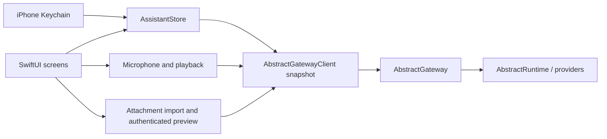

# iPhone architecture

`Sources/App` owns native views, Keychain access, recording and playback. The `AssistantKit`
Swift package owns account-scoped state and URL validation. Its second target,
`AbstractGatewayClient`, contains the HTTP wire types and protocol.

The gateway remains the source of truth for session history, workflows, tools, approval
policy, entities, model/voice defaults and automations. The app reads account preferences
before starting a turn, chooses the explicit catalog workflow when set, otherwise uses
`@default` with `abstractassistant.agent.v1`. A missing/broken choice fails visibly without
switching interfaces. The workflow picker writes only the account’s Assistant interface preference. Operator
defaults and other app preferences are never changed. Voice overrides and read-aloud
preferences are stored locally, scoped by gateway/tenant/account.

The HTTP client uses an ephemeral URLSession, explicit bearer or session/CSRF headers,
and refuses redirects. A 401 locks the client out; the store removes the sign-in and stops
polling rather than repeatedly hitting the gateway’s failed-sign-in limit. Credentials are
Keychain items, with device-only accessibility, and are never encoded in a URL or passed
as launch arguments.

Store generations separate account changes and conversation changes. Old refreshes and
answers cannot repopulate a later account’s screen. Restoring a persisted session also
restores its visible history before sending is enabled. A failed/uncertain run-start POST
is never retried automatically: the user checks Conversations before resending.

Only a foreground task polls, with no overlapping refresh. Backgrounding stops the poll,
microphone and playback; it does not cancel a durable run. Stop is an explicit gateway
command. Tool approvals re-read the current run and wait key before sending a decision.

## Relationship to the Watch app

The initial client snapshot comes from `watch/apple/Packages/AbstractGatewayClient`.
`Packages/AssistantKit/WATCH_SNAPSHOT.json` records the source-file hashes. This isolates
the phone from ongoing Watch edits and avoids changing the Watch’s package or builds.
Phone changes add account workflow preference resolution and selection, artifact upload
and authenticated downloads, the Assistant interface/persona,
HTTP diagnostics and phone-oriented demo prose. Credential persistence and UI are entirely
separate. A shared package can be extracted after both clients’ APIs settle.

## Voice lifecycle

`VoiceTurn` is a local capture policy: authorizing → recording → countdown → ready →
transcribing. Only `claimForTranscription` permits the network handoff, exactly once.
Release seals the local WAV and starts a fresh three-second deadline on a monotonic clock.
Touch-down during grace cancels synchronously; it cannot start a replacement recording.
Quick taps, a permission grant after release, keyboard focus, navigation, backgrounding,
audio interruption and lost routes discard pending audio. At 60 seconds capture seals and
waits for actual release, retaining the user's ownership of the hold. A voice message sends
separately from a typed draft and includes the currently staged attachment references.

`VoiceController` owns recorder/player lifetime, generation guards, temporary-file cleanup
and network-task cancellation through chat. AVAudioRecorder and AVAudioPlayer feed
average/peak power into the same finite fast-attack/slow-release `AudioEnvelope`. A sleeping
main-actor Task samples every 33 ms independently of run-loop modes, so touch tracking
cannot pause metering. Only `VoicePresence` observes the envelope; message layout does not
rerender on every sample. The dot-free orb's silhouette, rings and light respond to energy.
A small isolated TimelineView maintains continuous ring motion. Reduce Motion freezes
rotation/scale while retaining signal-driven light. Timers/tasks and audio stop on exit.

The independent attachment control sits beside the text panel and orb. The empty,
unfocused text panel takes half its normal width; the controls align to the actual orb
center, with its caption below. Idle instructions are not repeated beneath the row.
Keyboard focus expands the text panel and removes the orb with
a spring transition; focus cancels pending voice before hiding its cancel control. A native
UIControl surface supplies reliable down/up/drag-cancel events and a VoiceOver toggle path.
The Debug-only `--demo --ui-test --voice-fixture` capture is isolated from live gateways;
it lets native UI tests exercise hold/countdown without device microphone permission.

`AssistantStore.completedReply` signals only a newly completed current turn. Automatic
reading listens for this event while active, rather than message-list refreshes, so restored
history and repeat polls remain silent. Entity speech retains its entity scope and voice.
Per-request provider/model/voice overrides follow the newer Watch client contracts.

## Files and automations

Uploads are stored by `POST /attachments/upload` with the current session ID. Returned
`$artifact` plus `run_id` references are carried in both input attachments and the agent’s
context/media fields, matching the tray. Session artifact listing includes files from child
runs; the owner from each artifact is used for its download. IDs are validated before
constructing a gateway route. Size checks cap imports and streamed downloads at 25 MB.
Only app-owned local files reach QuickLook; account/session changes remove preview data.
Picker origin and task generations prevent stale files crossing accounts or conversations.

Automation creation shares the Watch’s NewAutomation schema, eligible-workflow endpoint,
input-schema preflight and schedule@2 presets. Ask-before-tools defaults on. Daily clock
times follow the account time zone reported by the gateway. A pending creation retains its
request ID across retries, preventing uncertain responses from duplicating routines. The
creation response is retained for navigation even if refreshing the list fails. Shared
catalog workflows unsupported by automations v1 remain a gateway validation error.
