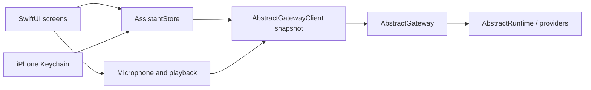

# iPhone architecture

`Sources/App` owns native views, Keychain access, recording and playback. The `AssistantKit`
Swift package owns account-scoped state and URL validation. Its second target,
`AbstractGatewayClient`, contains the HTTP wire types and protocol.

The gateway remains the source of truth for session history, workflows, tools, approval
policy, entities, model/voice defaults and automations. The app reads account preferences
before starting a turn, chooses the explicit catalog workflow when set, otherwise uses
`@default` with `abstractassistant.agent.v1`. A missing/broken choice fails visibly without
switching interfaces. No server defaults are written by this app.

The HTTP client uses an ephemeral URLSession, explicit bearer or session/CSRF headers,
and refuses redirects. A 401 locks the client out; the store removes the sign-in and stops
polling rather than repeatedly hitting the gateway’s failed-sign-in limit. Credentials are
Keychain items, with device-only accessibility, and are never encoded in a URL or passed
as launch arguments.

Store generations separate account changes and conversation changes. Old refreshes and
answers cannot repopulate a later account’s screen. Restoring a persisted session also
restores its visible history before sending is enabled. A failed/uncertain run-start POST
is never retried automatically: the user checks Conversations before resending.

Only a foreground task polls, with no overlapping refresh. Backgrounding stops the poll,
microphone and playback; it does not cancel a durable run. Stop is an explicit gateway
command. Tool approvals re-read the current run and wait key before sending a decision.

## Relationship to the Watch app

The initial client snapshot comes from `watch/apple/Packages/AbstractGatewayClient`.
`Packages/AssistantKit/WATCH_SNAPSHOT.json` records the source-file hashes. This isolates
the phone from ongoing Watch edits and avoids changing the Watch’s package or builds.
Phone changes add account workflow preference resolution, the Assistant interface/persona,
HTTP diagnostics and phone-oriented demo prose. Credential persistence and UI are entirely
separate. A shared package can be extracted after both clients’ APIs settle.
