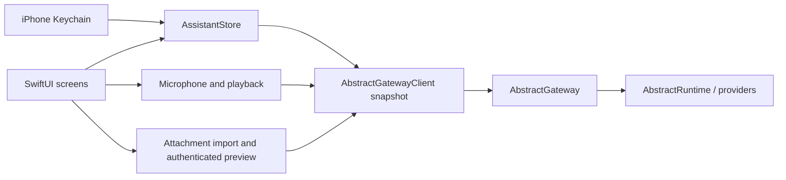

# iPhone architecture

`Sources/App` owns native views, Keychain access, recording and playback. The `AssistantKit`
Swift package owns account-scoped state and URL validation. Its second target,
`AbstractGatewayClient`, contains the HTTP wire types and protocol.

The gateway remains the source of truth for session history, workflows, tools, approval
policy, entities, model/voice defaults and automations. The app reads account preferences
before starting a turn, chooses the explicit catalog workflow when set, otherwise uses
`@default` with `abstractassistant.agent.v1`. A missing/broken choice fails visibly without
switching interfaces. The workflow picker writes only the account’s Assistant interface preference. Operator
defaults and other app preferences are never changed. Voice overrides, playback speed and read-aloud
preferences are stored locally, scoped by gateway/tenant/account.

The HTTP client uses an ephemeral URLSession, explicit bearer or session/CSRF headers,
and refuses redirects. A 401 locks the client out; the store removes the sign-in and stops
polling rather than repeatedly hitting the gateway’s failed-sign-in limit. Credentials are
Keychain items, with device-only accessibility, and are never encoded in a URL or passed
as launch arguments.

Store generations separate account changes and conversation changes. Old refreshes and
answers cannot repopulate a later account’s screen. Restoring a persisted session also
restores its visible history before sending is enabled. A failed/uncertain run-start POST
is never retried automatically: the user checks Conversations before resending.

Only a foreground task polls, with no overlapping refresh. Backgrounding stops the poll,
microphone and playback; it does not cancel a durable run. Stop is an explicit gateway
command. Stop intent is recorded before awaiting the start response, so a late run ID is
cancelled instead of abandoned. Root cancellation is sent once and the store follows the
run until its terminal state. Entity visits retry closure while the gateway holds its
writer lease. The square stays in its stopping state until confirmation; failures leave
a retry action and conversation recovery available. Completed stopped turns cannot trigger
automatic reading, and late send responses cannot restore the stopped visit. Tool approvals re-read the current run and wait key before sending a decision.

## Relationship to the Watch app

The initial client snapshot comes from `watch/apple/Packages/AbstractGatewayClient`.
`Packages/AssistantKit/WATCH_SNAPSHOT.json` records the source-file hashes. This isolates
the phone from ongoing Watch edits and avoids changing the Watch’s package or builds.
Phone changes add account workflow preference resolution and selection, artifact upload
and authenticated downloads, the Assistant interface/persona,
HTTP diagnostics and phone-oriented demo prose. Credential persistence and UI are entirely
separate. A shared package can be extracted after both clients’ APIs settle.

## Voice lifecycle

`VoiceTurn` is a local policy: authorizing → recording ↔ countdown → ready → transcribing.
Only `claimForTranscription` permits a network handoff, once. A tap activates capture.
`SpeechActivity` applies an adaptive raw-power gate with onset/offset hysteresis; confirmed
speech requires 180 ms of observed activity. Three quiet seconds after speech permit the
handoff. Resumed speech is processed before expiry and resets the quiet window. Recording
continues during the countdown, so a second phrase stays in the same local WAV. Initial
quiet/brief impulses never start a message; eight seconds without confirmed speech and
60 seconds of total capture discard locally. The hard duration limit wins over commit.

Touch-down while capture is pending cancels synchronously, even if the finger lifts after
the old deadline. No upload/STT happens before ready. Unknown meter values and sample gaps
over 250 ms reset the quiet/onset window; unobserved time is never inferred as silence.
Camera/navigation/account/session/background/audio-interruption paths cancel pending voice.
Permission completion checks current UIApplication state and generation before recording;
it briefly waits for prompt dismissal to activate the app and otherwise requires a new tap.
A voice turn sends separately from any typed draft, with currently staged attachments.

`VoiceController` owns recorder/player lifetime and temporary-file cleanup. Chat owns the
cancelable transcription task. A main-actor Task samples every 33 ms independently of run
loop modes. Raw power drives silence detection; two separate fast-attack display envelopes
drive the orb. `MicrophoneEnvelope` normalizes
recorder power against a recent peak and room floor with an 18 dB minimum span; short
syllables remain visible even when absolute microphone levels are much lower than mastered
playback. A low-variance window can update the visual baseline after 45 stable samples
without changing the raw speech decision. A perfectly sustained sound may therefore soften
visually. `AudioEnvelope` retains the playback soft knee for actual AVAudioPlayer power. Only the
small `VoicePresence` subtree observes the envelope. Continuous phase survives state changes;
voice rendering requests up to 60 Hz, working-state rendering up to 30 Hz; idle rendering is slower
and background rendering stops. The soft knee preserves differences
between loud syllables without saturating at ordinary playback levels. Energy changes
the ribbons’ curvature, spacing, rotation and stroke, independently of the raw silence gate. Reduce Motion freezes geometry
and rotation while retaining responsive light. The Debug-only
`--demo --ui-test --voice-fixture` supplies speech followed by silence, isolated from live
credentials and Release builds, to exercise tap/cancel/automatic send in native UI tests.

During a gateway turn, the same orb contour morphs into a rounded square with a stable
Stop glyph. Its surrounding ribbons continue moving; the hit target stays 84 × 80 points.
The sole progress row belongs to the conversation. Touch-down consumes the Stop action,
so releasing after cancellation cannot activate the microphone. Repeated touches within
450 ms of cancellation are consumed. Reduce Motion keeps a static, recognizable square.

The composer uses separate floating + and keyboard buttons on the left and the orb on the
right, without a shared panel. The keyboard button cancels pending capture and expands
the editor into the available width while hiding the orb. A separate composing state
mounts the editor before requesting keyboard focus; its cancelable task checks that the
editor is still open before focusing. The field is removed while minimized, including
from accessibility. The keyboard button's accessibility value reports a preserved draft.
Outside taps dismiss editing and restore the floating controls. Only a small Listening
label sits above the
active orb; there is no visible voice Cancel/countdown or Done
button in chat. `OutsideInputDismissal` installs a screen-owned UIKit recognizer rather
than a window handler. It excludes text/caret/selection touches, allows simultaneous
recognition, never cancels the outside control's event and defers focus changes until that
action can finish. Native tests exercise field/caret taps, outside dismissal, Send, orb and
opening the attachment menu with one tap while editing. Leaving the screen detaches it.

`AssistantStore.completedReply` signals only a newly completed current turn. Automatic
reading listens for this event while active, rather than message-list refreshes, so restored
history and repeat polls remain silent. Entity speech retains its entity scope and voice.
Per-request provider/model/voice overrides follow the newer Watch client contracts.

## Voice settings and responder selection

The Watch's pick-and-preview flow is preserved: selecting a voice immediately requests a
short sample, and selecting a speed previews the current voice. Separate view-owned
controllers stop old previews when navigating, backgrounding or changing account; recorder/
player generations suppress obsolete completions. Speed is one of 1, 1.15, 1.3 or 1.5,
stored per gateway/account and applied locally through AVAudioPlayer.enableRate/rate before
playback. It applies to Assistant and entity speech while entity voice overrides remain
entity-owned. Invalid persisted speeds restore to 1. No speed is sent to TTS providers.

The chat title is a labelled responder chooser. Files/settings move into one More menu,
avoiding an adaptive toolbar that hides actions. Who answers lists Assistant and searchable
entities with explicit loading/error/retry. Entity discovery can load independently of the
store's run polling chain. Switching is blocked with a reason during an active run/import
or staged files; drafts are preserved.

Entity creation uses the existing principal-scoped gateway endpoints. A cancelable name
check calls POST /entities/{slug}/validate before enabling the explicit Create action; the
same trimmed name and default-framework body then goes to POST /entities. The form discloses
permanence before mutation. No local model, spark or administrator permissions are invented.
Creation decodes manifest.slug/name, created and all warnings, including skills/capability
setup warnings. Partial/existing outcomes remain visible with an Open conversation action,
rather than inviting another creation. Account generations reject obsolete completions.

## Files and automations

Uploads are stored by `POST /attachments/upload` with the current session ID. Returned
`$artifact` plus `run_id` references are carried in both input attachments and the agent’s
context/media fields, matching the tray. Session artifact listing includes files from child
runs; the owner from each artifact is used for its download. IDs are validated before
constructing a gateway route. Size checks cap imports and streamed downloads at 25 MB.
Only app-owned local files reach QuickLook; account/session changes remove preview data.
Picker origin and task generations prevent stale files crossing accounts or conversations.

Automation creation shares the Watch’s NewAutomation schema, eligible-workflow endpoint,
input-schema preflight and schedule@2 presets. Ask-before-tools defaults on. Daily clock
times follow the account time zone reported by the gateway. A pending creation retains its
request ID across retries, preventing uncertain responses from duplicating routines. The
creation response is retained for navigation even if refreshing the list fails. Shared
catalog workflows unsupported by automations v1 remain a gateway validation error.

## Conversation tool scope and metrics

`ConversationTools` is an explicit whitelist with Off, Auto and Approve modes. Assistant
turns carry the same enabled names in `input_data.tools` and `_runtime.allowed_tools`,
plus named `auto_approve_tools` and `require_approval_tools` in `_runtime.tool_policy`.
An empty list denies every tool; omitted policy inherits gateway defaults. Attachments and
policy travel in the same start request. This is the established desktop Assistant contract;
no additional tool-policy capability endpoint is required. Preferences use gateway/account,
responder and session keys. A compatibility client cannot silently discard an explicit policy.

Entity discovery uses `GET /entities/{name}/session-tools`. When its `visit_routes` field
is true, managed sessions open with the policy through the existing `visit/open` route,
then end through `visit/{run_id}/close` with `closed_by: pause`. The policy is installed
before the first tick. Gateways serving this inventory without `visit_routes` use the
compatible `/sessions` and `/end` aliases. Entity policy/state/decision routes remain
owner-bound. An approval is a persisted runtime wait; only its
exact key and a strict boolean decision are sent. The server executes through the entity's
own handler and rechecks its grant. Policy changes are accepted only between turns.
The phone reuses its session/visit IDs after reconnect, while generations prevent late
responses from crossing accounts or conversations. Legacy chat is used only when the
entity session-tool inventory is unavailable and no explicit policy was requested.

Message statistics are optional and answer-owned. Agent metrics fold the run's execution
subtree; elapsed time is the root wall span, not the sum of overlapping child durations.
Entity metrics cover only the latest completed turn between visitor-input parks, excluding
visitor idle time. Missing token usage remains unknown. Active streaming answers are not
cached as final measurements. Playback actions require both active playback and a matching
`readingID`, so only the spoken answer can expose Pause and Stop.

Automation history budgets are sent as `context.growing.max_tokens` only for growing
history with a custom positive value. Omission inherits the runtime default returned by
`GET /automations/defaults`. The budget is part of the creation retry fingerprint.

## Conversation tool categories

The phone preserves the gateway inventory’s `toolset`, risk tier and enabled/available
flags. Categories and tools sort by their declared names. Search matches category, tool
name and description and reveals matching rows without changing saved disclosure choices.
Rows disabled by the gateway retain its explanation and cannot be enabled by a session
choice. Saving an explicit policy keeps those rows Off; gateway inheritance remains a
separate mode. Draft changes require Save and are scoped to the original account and
conversation. The search toolbar keeps Close and Save reachable while filtering.

For older entity inventories, exact-name discovery metadata can supplement a missing
category/risk classification. The entity’s availability and approval defaults remain its
own. Unknown categories remain Other. The phone adds no category-wide approval shortcut.
