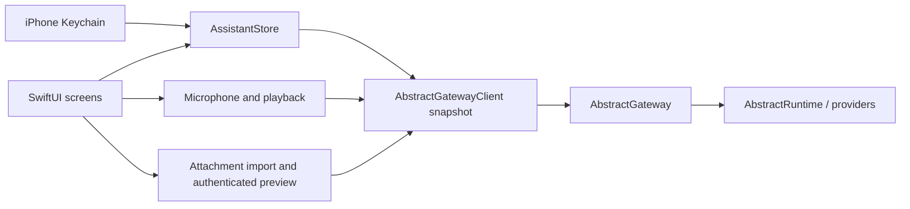

# iPhone architecture

`Sources/App` owns native views, Keychain access, recording and playback. The `AssistantKit`
Swift package owns account-scoped state and URL validation. Its second target,
`AbstractGatewayClient`, contains the HTTP wire types and protocol.

The gateway remains the source of truth for session history, workflows, tools, approval
policy, entities, model/voice defaults and automations. The app reads account preferences
before starting a turn, chooses the explicit catalog workflow when set, otherwise uses
`@default` with `abstractassistant.agent.v1`. A missing/broken choice fails visibly without
switching interfaces. The workflow picker writes only the account’s Assistant interface preference. Operator
defaults and other app preferences are never changed. Voice overrides and read-aloud
preferences are stored locally, scoped by gateway/tenant/account.

The HTTP client uses an ephemeral URLSession, explicit bearer or session/CSRF headers,
and refuses redirects. A 401 locks the client out; the store removes the sign-in and stops
polling rather than repeatedly hitting the gateway’s failed-sign-in limit. Credentials are
Keychain items, with device-only accessibility, and are never encoded in a URL or passed
as launch arguments.

Store generations separate account changes and conversation changes. Old refreshes and
answers cannot repopulate a later account’s screen. Restoring a persisted session also
restores its visible history before sending is enabled. A failed/uncertain run-start POST
is never retried automatically: the user checks Conversations before resending.

Only a foreground task polls, with no overlapping refresh. Backgrounding stops the poll,
microphone and playback; it does not cancel a durable run. Stop is an explicit gateway
command. Tool approvals re-read the current run and wait key before sending a decision.

## Relationship to the Watch app

The initial client snapshot comes from `watch/apple/Packages/AbstractGatewayClient`.
`Packages/AssistantKit/WATCH_SNAPSHOT.json` records the source-file hashes. This isolates
the phone from ongoing Watch edits and avoids changing the Watch’s package or builds.
Phone changes add account workflow preference resolution and selection, artifact upload
and authenticated downloads, the Assistant interface/persona,
HTTP diagnostics and phone-oriented demo prose. Credential persistence and UI are entirely
separate. A shared package can be extracted after both clients’ APIs settle.

## Voice lifecycle

`VoiceTurn` is a local policy: authorizing → recording ↔ countdown → ready → transcribing.
Only `claimForTranscription` permits a network handoff, once. A tap activates capture.
`SpeechActivity` applies an adaptive raw-power gate with onset/offset hysteresis; confirmed
speech requires 180 ms of observed activity. Three quiet seconds after speech permit the
handoff. Resumed speech is processed before expiry and resets the quiet window. Recording
continues during the countdown, so a second phrase stays in the same local WAV. Initial
quiet/brief impulses never start a message; eight seconds without confirmed speech and
60 seconds of total capture discard locally. The hard duration limit wins over commit.

Touch-down while capture is pending cancels synchronously, even if the finger lifts after
the old deadline. No upload/STT happens before ready. Unknown meter values and sample gaps
over 250 ms reset the quiet/onset window; unobserved time is never inferred as silence.
Camera/navigation/account/session/background/audio-interruption paths cancel pending voice.
Permission completion checks current UIApplication state and generation before recording;
it briefly waits for prompt dismissal to activate the app and otherwise requires a new tap.
A voice turn sends separately from any typed draft, with currently staged attachments.

`VoiceController` owns recorder/player lifetime and temporary-file cleanup. Chat owns the
cancelable transcription task. A main-actor Task samples every 33 ms independently of run
loop modes. Raw power drives silence detection; a separate fast-attack/slow-release
`AudioEnvelope` drives the orb from microphone or actual AVAudioPlayer power. Only the
small `VoicePresence` subtree observes the envelope. Continuous phase survives state changes;
idle rendering is slower and background rendering stops. Reduce Motion freezes geometry
and rotation while retaining responsive light. The Debug-only
`--demo --ui-test --voice-fixture` supplies speech followed by silence, isolated from live
credentials and Release builds, to exercise tap/cancel/automatic send in native UI tests.

The centered dock groups +, a compact text panel and an always-visible orb. Keyboard focus
expands the field; outside taps minimize it even with an unsent draft. There is no Done
button in chat. `OutsideInputDismissal` installs a screen-owned UIKit recognizer rather
than a window handler. It excludes text/caret/selection touches, allows simultaneous
recognition, never cancels the outside control's event and defers focus changes until that
action can finish. Native tests exercise field/caret taps, outside dismissal, Send, orb and
opening the attachment menu with one tap while editing. Leaving the screen detaches it.

`AssistantStore.completedReply` signals only a newly completed current turn. Automatic
reading listens for this event while active, rather than message-list refreshes, so restored
history and repeat polls remain silent. Entity speech retains its entity scope and voice.
Per-request provider/model/voice overrides follow the newer Watch client contracts.

## Files and automations

Uploads are stored by `POST /attachments/upload` with the current session ID. Returned
`$artifact` plus `run_id` references are carried in both input attachments and the agent’s
context/media fields, matching the tray. Session artifact listing includes files from child
runs; the owner from each artifact is used for its download. IDs are validated before
constructing a gateway route. Size checks cap imports and streamed downloads at 25 MB.
Only app-owned local files reach QuickLook; account/session changes remove preview data.
Picker origin and task generations prevent stale files crossing accounts or conversations.

Automation creation shares the Watch’s NewAutomation schema, eligible-workflow endpoint,
input-schema preflight and schedule@2 presets. Ask-before-tools defaults on. Daily clock
times follow the account time zone reported by the gateway. A pending creation retains its
request ID across retries, preventing uncertain responses from duplicating routines. The
creation response is retained for navigation even if refreshing the list fails. Shared
catalog workflows unsupported by automations v1 remain a gateway validation error.
