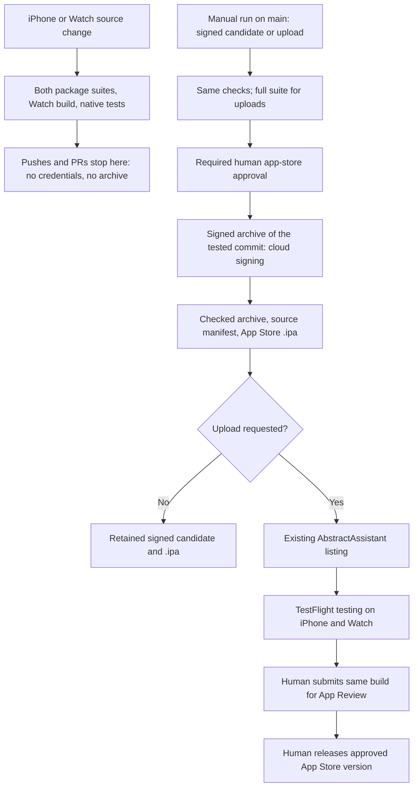

# Apple testing and distribution

AbstractAssistant uses one App Store Connect listing for iPhone and Apple Watch. The
[Apple app (iPhone + Watch) workflow](../../../.github/workflows/iphone.yml) is the Store
release entrypoint. It packages the iPhone app as `ai.abstractframework.assistant`, with
`ai.abstractframework.assistant.watchkitapp` embedded as an independent Watch companion (one
project, `phone/iphone/project.yml`, since 0.16.0; the earlier watch id
`ai.abstractframework.assistant.watch` is retired).
Use the existing **AbstractAssistant** app record; no second iPhone listing is needed.

## CI testing and candidate identity

PR/main changes to either client run release contract tests, both Swift package suites, a
Watch companion simulator build, iPhone hosted tests and critical UI journeys. Manual upload
requests always run the full iPhone UI suite. Live gateway tests are excluded; CI does not
need gateway credentials or generate paid media.

CI generates the one project (`xcodegen generate --spec phone/iphone/project.yml`) and tests
its iPhone target, which embeds the watch app. Pushes and pull requests do not archive: the apps
carry explicit entitlements, so a Release archive must be signed, and signing needs the App Store
Connect key that only the protected `app-store` environment holds. A manual run (below) archives
the tested commit there. Both apps
receive the marketing version from `phone/iphone/project.yml` and a shared CI build number
`(workflow run number + 100).run attempt`. The manifest records the source commit, both bundle
IDs, native test scope and SHA256 digest. Upload rejects missing Watch content, incompatible
companion settings, mismatched versions, test plugins and altered or unrelated archives.

CI uses released Xcode 27 and its own simulator. Tests are retained for 14 days, signed
candidate archives and `.ipa` exports for 30 days.

## Request a signed candidate or an App Store Connect upload

1. Open **Actions → Apple app (iPhone + Watch) → Run workflow** on **main**.
2. Check **Request human approval to sign and export the App Store candidate** for a signed
   `.ipa` only, or **Request human approval to sign and upload** to also upload it (uploads
   always run the full native UI suite).
3. After both clients pass their checks, select **Review deployments** and approve **app-store**.
   Only this protected job (**Sign, export and upload the combined candidate**) receives the
   App Store Connect key. It installs the Apple Distribution certificate in a temporary keychain,
   archives the tested commit with the tested version and build number using Xcode cloud signing
   (`-allowProvisioningUpdates` with the API key: Xcode creates or fetches the App Store
   provisioning profiles; none is stored in the repository), checks that all five bundles are
   signed by the team, exports the App Store `.ipa` (checked to be signed by Apple Distribution),
   uploads when requested, and always deletes the keychain and key files.
4. Wait for Apple processing, then select the processed build and testers/groups in the existing
   AbstractAssistant **TestFlight** page. External testing may require beta review.

The standalone **Watch developer checks** workflow checks developer builds. Its summary links
to the combined release entrypoint; it has no signing credentials or separate upload job.

The `app-store` GitHub environment must restrict deployment to **main** and require a human
reviewer. Developer team `K3R4D6HP2A`; the signing credentials:

| Secret | Where | Value |
|---|---|---|
| `APPLE_DISTRIBUTION_P12_BASE64` | repository | Base64 of the "Apple Distribution" certificate with its private key (PKCS12) |
| `APPLE_DISTRIBUTION_P12_PASSWORD` | repository | That PKCS12's password |
| `ASC_KEY_ID` | `app-store` environment | Team App Store Connect API key ID |
| `ASC_ISSUER_ID` | `app-store` environment | That API key's issuer ID |
| `ASC_KEY_P8` | `app-store` environment | Complete private `.p8` key text |

The signed job names any missing secret and fails; it never falls back to an unsigned archive.
The bundle IDs it signs: `ai.abstractframework.assistant`, `.notifications`, `.watchkitapp`,
`.watchkitapp.orbclock` and `.watchkitapp.notifications`, all in app group
`group.ai.abstractframework.assistant`.

The key needs automatic provisioning/cloud-managed signing permissions. Private key files are
created only in a private runner-temporary directory and removed after export, including failure.
No private key is retained in candidate artifacts. Complete outstanding Apple agreements if required.

## TestFlight and public App Store release

This is a normal App Store Connect upload, with **TestFlight Internal Only disabled**. Uploading
does not distribute to tester groups, submit App Review or publish the app automatically.

After beta validation on both devices, select the **same version and build** in App Store Connect.
Complete screenshots for supported devices, privacy details, age rating, support information and
review access. Choose **manual release**, submit App Review, then release explicitly once approved.

The Watch companion works independently: it can connect directly to its gateway without the iPhone
app running or installed. Once an iPhone companion is published on the App Store, Apple does not
support returning that listing to a watch-only app.

## Developer installs and test data

Developer builds use the Store bundle IDs (`ai.abstractframework.assistant`, `.watchkitapp`);
the earlier developer-only `ai.abstractframework.assistant.iphone` and the watch's
`ai.abstractframework.assistant.watch` are retired. Their installs keep their own sandbox:
sign in again once in the new app (the watch then follows the iPhone's sign-in). Both clients can load
authorized sessions from the gateway.

TestFlight and App Store share one Store bundle ID and replace one another on a device. To keep
server data separate during beta testing, use a test gateway/account. A separately installable
staging Store app would require another bundle ID and app record. See the [build guide](../BUILD.md)
for local developer installs.

## References

- [ADR 0002: release stages](../../../docs/adr/0002_iphone_release_stages.md)
- [ADR 0003: combined Apple product](../../../docs/adr/0003_unified_apple_product.md)
- [GitHub deployment reviews](https://docs.github.com/en/actions/how-tos/deploy/configure-and-manage-deployments/review-deployments)
- [Apple: adding an iPhone companion](https://developer.apple.com/documentation/technotes/tn3157-updating-your-watchos-project-for-swiftui-and-widgetkit)
- [Apple: upload builds](https://developer.apple.com/help/app-store-connect/manage-builds/upload-builds)
