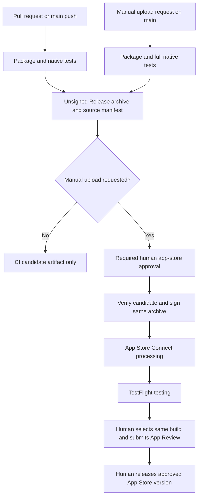

# iPhone testing and distribution

The [iPhone app workflow](../../../.github/workflows/iphone.yml) separates CI checks, beta delivery
and public App Store publication. The iPhone app uses bundle ID
`ai.abstractframework.assistant.iphone`; it is independent of the Watch app’s store container.

## CI testing

Pull requests and changes to the iPhone client on `main` run package tests, native hosted tests
and critical UI journeys for images, stopping work, tool categories and conversation history.
A manual run can select the full UI suite; upload requests always require it. Live gateway tests
are excluded, so CI does not need gateway credentials or generate paid media.

The runner selects a released Xcode 27 toolchain, creates its own iPhone simulator and builds an
unsigned device Release archive. No Apple credentials are available to these jobs. Test results
are retained for 14 days; candidate archives for 30 days. Each candidate includes its source
commit, bundle identifier, marketing version, CI build number, native test scope and SHA256 digest.
Adding explicit signing entitlements requires an archive-signing configuration; the unsigned
candidate path refuses them rather than dropping capabilities.

## First-time App Store Connect setup

Create an **iOS app record** in App Store Connect for `ai.abstractframework.assistant.iphone`
before requesting the first upload. Choose its name, primary language and SKU there. This app
record is separate from the Watch container. Complete any outstanding Apple Developer agreements.

Configure the repository’s **app-store** GitHub environment with a required human reviewer and
an allowed deployment branch of **main**. This repository shares that protected environment
with Watch; changes to its reviewers or secrets affect both upload workflows. The uploader uses:

| Environment secret | Value |
|---|---|
| `ASC_KEY_ID` | App Store Connect API key ID |
| `ASC_ISSUER_ID` | API key issuer ID |
| `ASC_KEY_P8` | Complete private `.p8` key text |

Use a team API key with the permissions needed for automatic provisioning and cloud-managed
signing. The workflow’s `TEAM_ID` must match the Apple developer team. Keys are written only to
a private runner-temporary directory and removed after export, including failed exports.
No private keys are retained in candidate artifacts or committed to the repository.

## Request a beta upload

1. Open **Actions → iPhone app → Run workflow** and select **main**.
2. Check **Request human approval to upload**. This also enables the full native suite.
3. After CI passes, inspect its test results and candidate summary: commit, version, build
   number and checksum.
4. Select **Review deployments** and approve **app-store** to allow Apple credential access
   and upload. A push, pull request or unchecked manual run cannot perform this step.
5. Wait for Apple processing, then use **TestFlight** in App Store Connect to select testers
   and groups. External testing may require Apple’s beta review.

The upload job verifies and signs the archived candidate without rebuilding. Marketing version
comes from `project.yml`. CI build numbers use `(workflow run number + 100).run attempt`, so retrying
a run produces a new build number. The workflow refuses values beyond Apple’s numeric limits.

This is a normal App Store Connect upload, with **TestFlight Internal Only disabled**. It can
therefore be tested in TestFlight and later selected for App Review. Uploading does not submit
App Review, distribute to tester groups automatically or publish a public App Store version.

## Promote the tested build to the App Store

After beta testing, select the **same marketing version and build number** in the iPhone app’s
App Store Connect version. Complete required screenshots, privacy details, age rating, support
information, review access and other store metadata. Choose **manual release**, then submit
that version for App Review. Once approved and ready, release it explicitly in App Store Connect.
No second upload or rebuild is needed for this promotion.

These are distribution stages, rather than separate staging and production apps or gateways.
TestFlight and App Store use one bundle ID and replace one another on a device. To keep server
data separate during testing, sign in to a test gateway/account. Local developer installs remain
available through the [build guide](../BUILD.md). A separately installable staging app would
require a different bundle ID, app record and signing setup.

## References

- [ADR 0002: release stage boundaries](../../../docs/adr/0002_iphone_release_stages.md)
- [GitHub: review deployments](https://docs.github.com/en/actions/how-tos/deploy/configure-and-manage-deployments/review-deployments)
- [Apple: test your beta app](https://developer.apple.com/tutorials/develop-in-swift/test-your-beta-app)
- [Apple: upload builds](https://developer.apple.com/help/app-store-connect/manage-builds/upload-builds)
