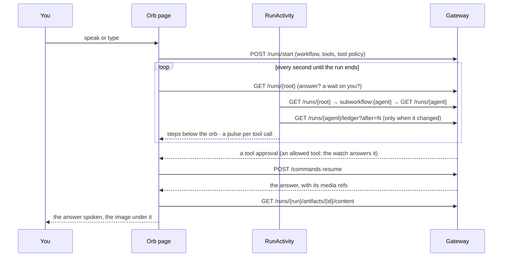

# Architecture: AbstractAssistant for Apple Watch

The watch app follows ADR 0001 of this repository: the gateway is the authority for workflows,
runs, tools, policy and speech; the watch holds a credential and what it shows, and every action it
takes is a gateway request. Since 0.16.0 it is the companion of the AbstractAssistant iPhone app
(one product, one project: [`../../phone/iphone/project.yml`](../../phone/iphone/BUILD.md)) and stays
independent: it signs in and runs with no iPhone nearby.

```mermaid
flowchart LR
  subgraph Watch["Apple Watch (watchOS 26+, the iPhone app's independent companion)"]
    UI[SwiftUI screens]
    Model[AppModel<br/>polling · haptics · state]
    Media[Listener · Speaker<br/>microphone · voice playback]
    Work[RunActivity<br/>live steps · orb pulses]
    Files[MediaStore<br/>images · recordings · cache]
    BG[AnswerNotifier · RuntimeKeeper<br/>background · notifications · keep awake]
    Kit[AbstractGatewayClient<br/>Swift package]
    Store[(Keychain, app group<br/>gateway · credential · reg)]
    Push[WatchPush · WatchLink<br/>APNs registration · iPhone handoff]
    NSE[notification service extension<br/>renders a push from the event]
    Push --> Store
    NSE --> Store
    UI --> Model --> Kit
    UI --> Media --> Kit
    UI --> Work --> Kit
    UI --> Files --> Kit
    BG --> Kit
    Kit --> Store
    Face[(app group<br/>FaceSnapshot)]
    Clock[Assistant complication<br/>WidgetKit]
    Model --> Face
    BG --> Face
    Face --> Clock
  end
  subgraph GW["AbstractGateway (HTTPS)"]
    API[/api/gateway/*/]
    Runs[(runs · ledgers · waits)]
    Auto[automations]
    Ent[entities]
    Voice[speech-to-text · text-to-speech]
    Art[(artifacts<br/>images · recordings · files)]
    Search[(conversation search index<br/>per account)]
    API --> Runs
    API --> Auto
    API --> Ent
    API --> Voice
    API --> Art
    API --> Search
  end
  Kit -- "Bearer token, or session + CSRF" --> API
  Other[Desktop assistant · terminal · browser] --> API
```

A wait answered on the watch is answered for every client; a question asked on the watch is a run
in the same session pool as the desktop assistant's.

### One question, while it works

## Components

| Component | Responsibility |
|---|---|
| `Sources/App` (SwiftUI) | Screens and navigation (one `NavigationStack`); see [design.md](design.md). |
| `AppModel` (`@MainActor`) | The client, the state on screen (waits, sessions, automations, entities), each automation's definition and latest results once read (shared by its pages, updated by a save), the 15 s poll while the scene is active (the automations list at most once a minute; none while the screen is dimmed or the app is in the background), haptics, tool and workflow choices, the tools Accept all allowed, the answers seen on this watch. |
| `Orb`, `OrbScenes`, `OrbConcepts`, `OrbCosmos`, `OrbNature`, `OrbAvatars`, `OrbLines`, `OrbRobots`, `OrbMachines` | The orb (every style drawn from `OrbPhases`, the five phases' weights and the voice): a planet of points whose style answers the voice (Halo, Vortex, Nebula, Liquid, Galaxy), and scenes of their own: Rings, the five state shapes (Lotus, Crystal, Eclipse, Synapse, Drop), Face, Imprint, Contour, Membrane, Eye (one relief of the face, computed once on a grid for the line styles), the eleven machines (six robots, a floating robot, a robot on tracks, a car, an android and a chrome sentinel, drawn as lit metal under a fine texture of points), the Cosmos scenes (Well, Black hole, Accretion) and the Nature scenes (Ocean, Aurora, Murmuration); every motion at a fixed pace, the phases blending how much of each shows, so a change of state is always a smooth morph; all frame-rate independent and drawn in one `Canvas`, with the light of its work. |
| `Listener` | Records 16 kHz mono WAV with metering; detects speech against the room's noise floor; sends after 3 s of silence. |
| `Speaker` | Streams the gateway's voice in chunks and plays them back to back with metering (the orb follows the level); pause, resume, rewind 10 s. |
| `AskView`, `Conversation`, `AutomationFeed` | The one orb page, for a conversation and for an automation: `Conversation` says which, `AutomationFeed` gives an automation's runs as messages (`/occurrences`, its trigger's `user_turn`), its run in progress, Stop, Seen and the conversation about it (`/discuss`); the page follows a run the same way for both (`RunActivity`). |
| Browser navigation | `AppModel.path` is the history: a swipe to the right (`goBack`) closes the top page, a swipe to the left (`goForward`) opens again the pages closed by going back (`forward`, kept until something else is opened; only the app's own pages are kept, `Route.revisitable`: a message, its steps, media, a link, a form or a question opens with a tap only); rows and links fire on a tap only (`TapButtonStyle`: a finger that moves is not a tap), and the stack's binding (`stackPath`) also refuses a page opened under a sideways-moving finger, so a swipe across a row never opens it; with nothing ahead, and only from there, the orb page of a conversation with a message opens `ConversationInfoView` (its numbers, and its files from `GET /sessions/{id}/artifacts` and the conversation's folder through `GET /runs/{id}/workspace/files`, each shared as a file downloaded only when shared). |
| `RunActivity` | Follows a question's run down to the run doing the work and reads its new step records (thinking, tool calls, media, waits) into the steps under the orb and the orb's pulses and satellites. |
| `SVGDocument`, `SVGView` | SVG drawn on the watch (it has no web view): the client library reads a drawing into shapes and texts with their transforms, inherited styles, gradients, dashes and blur or drop-shadow filters (rect, circle, ellipse, line, polyline, polygon, every path command with arcs, text, groups); the app draws them in one `Canvas`, fitted with their aspect kept. Not drawn: embedded images, `use`, masks, clip paths, patterns, CSS stylesheets. Used by the file preview (`FilePreviewView`, a vertical pager over the conversation's files) and the media page. |
| `MediaStore` | Downloads an answer's images, recordings and videos from the gateway's artifact route once, keeps them in the watch's caches (150 MB at most) and makes pictures small on the watch. |
| `AnswerNotifier` | Hands a run's ledger stream to a background URLSession once the app leaves the foreground (one per run, ended when the app sees the run end), posts answers and waits as notifications; the background refresh and each launch read the event stream once (`GET /me/events?after=`) and post what is new. |
| `FaceSnapshot`, Assistant complication | What the watch face shows (your avatar, waits for you, the first of them, the next automation, the results not seen), kept in the app group `group.ai.abstractframework.assistant`: written by `AppModel` when its waits or automations change and by the background refresh; the avatar is the chosen orb style drawn by the app (`FaceSnapshot.drawAvatar`, trimmed to the drawing) whenever the style changes, in the face's three states (`FaceState`: at rest; speaking for news, results or messages not seen; listening for what needs you), two PNGs per state in the group's `Library` folder: in colour, and its light as transparency for a face that draws its complications in one tint (the complication draws that one as a mask in the face's accent, scaled to the slot's pixels: a face refuses a picture much larger than its slot). Until the app has drawn it, the complication shows the app's own orb from its assets (`Complication/Assets.xcassets`, `Orb` and its mask `OrbMask`). A write that changes it asks WidgetKit for a new timeline. The complication (`Sources/Complication`, the `AbstractAssistantComplication` extension embedded in the app) reads it every five minutes for two hours; it never calls the gateway itself. Its views (`Sources/Face`) are shared by the app (`--screen face` shows them in debug builds). |
| `RuntimeKeeper` | An extended runtime session while the app listens, works or speaks, so the voice continues with the wrist down. |
| `AbstractGatewayClient` (SwiftPM) | Typed async client of every Apple client (the iPhone's `AssistantKit` depends on it; backlog 1053 step 3 folded the iPhone's copy, `PhoneGatewayClient`, back into it): models, endpoints, markdown and speech text, sign-in; reads (GET) that time out, lose their connection or meet a server error are tried 3 times before they fail (the iPhone constructs it with `readTries: 1`), writes are sent once ([ADR-0039](https://github.com/lpalbou/AbstractFramework/blob/main/docs/adr/0039-loading-states-spinner-until-a-read-has-failed.md) of AbstractFramework); `MockGatewayClient(world: .watch)` with the same protocol for previews, screenshots and UI tests (the iPhone's `world: .phone` keeps its own sample answers, tools and automations). Tested with `swift test`. |

## Gateway calls behind each screen

| Screen / action | Gateway call |
|---|---|
| Sign in with a token | `GET /api/gateway/me` (must name the account typed) |
| Sign in with an email | `POST /api/gateway/session/recovery/request`, then `POST /api/gateway/session/recovery/redeem` (`remember: true`); the session and CSRF values are sent as `X-AbstractGateway-Session` / `X-AbstractGateway-CSRF` |
| Needs you | `GET /api/gateway/runs?status=waiting`, then `GET /api/gateway/runs/{id}` for each waiting row (the approval lives on the agent's child run) |
| What happened while closed | `GET /api/gateway/me/events?after=<sequence>&limit=` (one request per background refresh and per launch; CloudEvents `attention.raised`/`attention.seen`/`run.finished`) |
| Allow / deny / answer | `POST /api/gateway/commands` `{type: "resume", payload: {wait_key, payload: {approved} or {response}}}`; the run is read again first, and a wait answered elsewhere is not answered twice |
| Approve all (an approval) | for the run's owner, read from the run itself (`session_id`, `automation_id`, also on an agent's run below an occurrence): a conversation (its tools: the watch's defaults and its own changes) or an automation (its own tools: `input_data._runtime.allowed_tools` and `tool_policy`). It allows that owner's tools on Ask, up to the risk of the call approved (at least "makes changes"); Off tools stay off, sends and tools whose destination the assistant picks keep asking. Allowed tools stay on Ask in the run's `_runtime.tool_policy` (fixed when a run starts); the watch answers their approvals (`POST /api/gateway/commands` resume) when every call is allowed for that owner: while it follows the run, and in its regular check of what needs you (there only what Approve all allowed, never the watch's defaults). The shield, Ask again on the Tools page or on the automation's details clear them, so the next call asks |
| Ask the Assistant | `POST /api/gateway/runs/start` `{flow_id: "@default", interface: "abstractcode.agent.v1", session_id, input_data: {prompt, use_session_history: true, system, tools, _runtime.allowed_tools}}`, then `GET /api/gateway/runs/{id}`; `tools` lists every tool `GET /api/gateway/discovery/tools` reports enabled and available (as the desktop assistant), and `system` is added after the agent's own loop and tool rules. With the Assistant's workflow (`interface: "abstractassistant.agent.v1"`), the conversation's newest image goes as `primary_image_artifact` (`{$artifact, run_id, content_type}`, also in `context`) with `has_primary_image_context`, as the iPhone and the menu-bar Assistant send it: an edit, an upscale or an image-to-video starts from it |
| Ask an entity | `GET /api/gateway/entities`, `POST /api/gateway/entities/{name}/chat/open`, `POST .../chat/{id}/turn`; the entity row's `appearance` gives its orb |
| Voice in | `POST /api/gateway/attachments/upload` (multipart, `session_id`), `POST /api/gateway/runs/{session owner}/audio/transcribe` |
| Voice out | `POST /api/gateway/runs/{id}/voice/tts/stream` (an entity: `POST /api/gateway/entities/{name}/voice/tts/stream`); the whole text in one request (the gateway speaks it in whole sentences); playback starts once 1.5 s of speech is queued and plays at the speed chosen on the watch |
| Tools | `GET /api/gateway/discovery/tools` (group `toolset`, `description`, `risk_tier`, `enabled`, `approval_default`); each run sends the tools on Auto or Ask as `tools` and `_runtime.allowed_tools`, and `_runtime.tool_policy {auto_approve_tools, require_approval_tools}`; choices are kept on the watch (defaults, then each conversation's changes) |
| Workflow | `GET /api/gateway/bundles?executable_for=abstractcode.agent.v1` and `…=abstractassistant.agent.v1` (newest version per bundle); a chosen one starts as `bundle_id`, `bundle_version`, `flow_id`, `interface`, `registry_scope`; none chosen: `flow_id: "@default"` of `abstractcode.agent.v1`; kept on the watch per conversation (defaults in Settings → Tools) |
| New answers | a conversation is new when its newest turn ended after the watch started counting and is not the turn last seen there (kept on the watch, `sessions.seen`); automations: the gateway's `attention.unseen_count` |
| Automation on/off, archive | `POST /api/gateway/automations/{id}/commands` `{type: "automation.pause" \| "automation.resume" \| "automation.archive" \| "automation.unarchive"}`; `GET /api/gateway/automations?archived_only=true` lists the archived ones; the automations list is read with up to 60 s per request and retried |
| Archive | `POST /api/gateway/sessions/{id}/archive` (and `/unarchive`): out of `GET /runs?root_only=true` on every client, nothing deleted; `GET /api/gateway/runs?archived_only=true&root_only=true` lists them |
| Search | `GET /api/gateway/sessions/search?q=…&limit=25` (AbstractRuntime `ConversationSearch`, the caller's own plane): one item per session with `snippet` and `highlights`; 404 on a gateway without it |
| Live work | the root's `GET /api/gateway/runs/{id}` each second, down its `subworkflow:<child>` waits to the run doing the work; that run's `GET /api/gateway/runs/{id}/ledger?after=N`, decoded for `effect.type`, `effect.payload.tool_calls[{name, arguments}]`, `effect.payload.output.modality`, `response_schema`, `result.results[{success, error}]`, `result.content`, `result.wait` only (a thinking record's conversation is skipped); a run that handed off to a child is not read again. About as much data as the run's records (a 90 s agent run with 6 tools: ~3 MB, mostly its thinking records) |
| Conversation files | `GET /api/gateway/sessions/{id}/artifacts`: `generated_media` and `attachment` rows; an attachment that a transcript (`tags.task == stt`) names as its `source_audio_artifact` is a spoken question, counted apart; a file's bytes come from `GET /api/gateway/runs/{run}/artifacts/{id}/content` when it is shared. The conversation's folder, when the gateway made it for the conversation or the run (`GET /api/gateway/runs/{run}/workspace` `kind` `session` or `run`): `GET /api/gateway/runs/{run}/workspace/files?recursive=true` (hidden files and caches left out; a refused folder lists nothing and leaves the other files shown), each file's bytes from `GET /api/gateway/runs/{run}/workspace/content?path=` |
| Media | a finished run's `output` (`outputs.{modality}[].artifact_ref`, `artifact`, `image_artifact`, `audio_artifact`, `video_artifact`); history: `GET /api/gateway/sessions/{id}/artifacts` (`tags.kind == generated_media`, by `run_id` and `parent_run_id`); bytes: `GET /api/gateway/runs/{run}/artifacts/{id}/content` (at most 25 MB), kept in the watch's caches, images shrunk on the watch |
| Sessions | `GET /api/gateway/runs?root_only=true&session_kind=chat,discussion&include_metrics=true`, a row's title is its latest run's prompt from `GET /api/gateway/runs/{id}/input_data` (none is made up); a conversation's history on the orb page: `GET /api/gateway/runs/{newest}/history_bundle?include_session=true&detail=replay` (one request) |
| Cancel / stop | `POST /api/gateway/commands` `{type: "cancel"}` |
| Automations | `GET /api/gateway/automations`; one automation `GET /api/gateway/automations/{id}` (`summary.current_occurrence` while it runs, `definition.target` for its task) |
| Run now / stop / pause / resume | `POST /api/gateway/automations/{id}/commands` `{type: "automation.run_now" \| "automation.stop_current" \| "automation.pause" \| "automation.resume"}` |
| Edit an automation | `PATCH /api/gateway/automations/{id}` `{expected_revision, changes}` with only what changed (`title`, `target`, `trigger`, `context` `{mode, growing: {max_tokens}}`; the limit shown is the row's `growing_max_tokens`, the automation's own or the gateway's default); a stale revision is refused (409) |
| New automation | `GET /api/gateway/automations/defaults` (`growing_max_tokens`, the memory a new one starts with), `GET /api/gateway/bundles?executable_for=abstractcode.agent.v1` (the workflows offered; the gateway decides), `GET /api/gateway/bundles/{bundle}/flows/{flow}/input_schema?bundle_version=` (a chosen workflow's defaults and required inputs), `POST /api/gateway/automations` `{request_id, title, target, trigger: schedule@2 {kind: every \| daily}, context, policy: {tool_approval}}` — the body the other clients send |
| An automation's messages | `GET /api/gateway/automations/{id}/occurrences?limit=` (each run's `user_turn`, `answer`, `fired_at`, `status`) |
| Talking about an automation | `POST /api/gateway/automations/{id}/discuss` `{request_id, occurrence_index, prompt}`: a `discussion-session:` conversation seeded with its runs, its first turn started; later turns `POST /runs/start` with that `session_id`. Nothing is written into the automation's own conversation. |
| Live progress | `GET /api/gateway/runs/{id}/ledger?after=` on the occurrence's run and the child runs it starts |
| Seen | `POST /api/gateway/automations/{id}/seen` `{attention_cursor}` |
| Links | the page itself, fetched by the watch and shown as readable text |

## Background and notifications

- **On screen** (the scene active, someone looking): waits, sessions and automations every 15 s;
  a running question or automation run every second, its steps every 2 s; an automation's orb page
  reads the automation every 10 s (a run its schedule starts). The screen
  dimmed (wrist down, always on): the poll in flight finishes and none follows; the orbs hold
  their last frame; the automations page reads nothing. In the background: nothing.
- **Answers while away**: an Ask left working when the app leaves the foreground hands
  `GET /api/gateway/runs/{id}/ledger/stream` (a keep-alive every 50 s) to a background URLSession,
  once per run. watchOS keeps it open with the app suspended and wakes the app when the gateway
  closes it; the app posts the answer as a notification. A running automation's orb page does the same
  when the app is left. The stream is ended when the app itself sees the run end or park on a
  person, and given up after an hour (15 minutes a connection, three reconnections). No
  notification is posted for an answer that is on screen.
- **While closed: your event stream, one request**: a background refresh, about every 15 minutes at
  the system's discretion, and each launch in front read `GET /api/gateway/me/events?after=<last
  sequence read>` once (no stream in the background). `AttentionState` (AbstractGatewayClient,
  `MeEvents.swift`, kept in the app's defaults) folds it: approvals and questions raised and not
  seen or ended (`attention.raised` with a `wait_key`, closed by `attention.seen` or the run's
  `run.finished`), automation results raised above the automation's latest `attention.seen`.
  Each new approval or question is posted once as **time-sensitive** ("Approval needed" / "A question
  for you"; a tap opens the waits list, which reads the waits live); each new automation result is
  posted once as **passive** news ("Morning digest has a result" / "… failed", names from the last
  automation list read; a tap opens it); an automation's run that finished without a result posts
  "… finished" (Settings → Notifications; a run already posted by its answer stream is skipped). The
  first read only takes stock: what happened before the watch first looked never notifies.
  The watch is its own device: it always notifies, then records each notice it showed with
  `POST /api/gateway/me/events/notifications {channel: "watch", outcome: "sent", record_key, device}`
  (its device id is kept on the watch; one request per notice shown, none otherwise).
  Time-sensitive needs the `com.apple.developer.usernotifications.time-sensitive` entitlement to
  break through a Focus; without it watchOS delivers it as an ordinary notification.
- **When the event stream is not read**: a look answers one of three ways: read, no stream (the
  gateway answered 404: an older gateway, remembered for a day per gateway so it is not asked on
  every look, then asked once more), or failed (a timeout, a 401, a proxy's page). In the last two
  the refresh reads the waits (the tools' risk tiers only when there is a new one) and posts each new approval or question once (an ordinary tool approval
  offers Allow, the watch must be unlocked, and Deny; a send or a destructive call opens the app),
  and reads the automations (`GET /api/gateway/automations`) to post one notification per automation
  whose latest run is newer than the one known on this watch. The app's own automation reads post
  the same notification, shown as a banner (none for an automation whose orb page is open).
- **Watch face**: the Assistant complication shows what the app last read; the refresh writes what
  the event stream says (needs you from the open approvals and questions, news from the unseen
  results) to the app group, the app writes its live waits and automations, and the face redraws
  only when they changed.
- **Keep awake**: `WKExtendedRuntimeSession` (`WKBackgroundModes: self-care`, up to 10 minutes)
  from the tap that starts a turn until the voice ends, a new conversation is started, or the
  player is dropped; never past the turn. A session about to expire while still held is renewed
  while the app is in front; one that could not start (wrist down) is taken when the app comes
  back in front.
- **The voice plays on**: a reading that is speaking always has something playing. The system can
  stop the player underneath (an audio interruption, the app suspended with the wrist down, the
  keep-awake session gone), and the player's "finished" callback never comes for that: an
  interruption pauses the reading and resumes it when the system allows; the app coming back in
  front plays on from where the voice stopped. Only the voice playing turns the audio session off
  when it ends (an idle player leaving the screen does not).
- **Push (framework backlog 1049)**: `WatchPush` asks for the APNs token at launch with a sign-in
  and after each sign-in; the shared `PushRegistrar` (package `AssistantPush`) sends
  `PUT /api/gateway/me/push/devices/{device_id}` with exactly `{token, topic, env, app: "watch",
  reg, name}` on a new token, a new sign-in or once a day, and `DELETE` at sign-out; `device_id`
  is the watch's notification-report id (`notify.device`). A gateway answering `relay: off` keeps
  the registration and nothing changes. The notification service extension (one source with the
  iPhone's) reads `s` and `r` from the push: another sign-in's `r` shows passive "From an earlier
  sign-in"; otherwise it reads `GET /me/events?after=s-1&limit=1` (8 s) and renders it as the
  catch-up would (approval/question time-sensitive with the `needs` user info; result/failure
  passive with the automation's name, kept in the app group; a published alert with its title).
  On timeout the generic localized text stays, and each push's outcome is a `PushTrace` line in the
  app group (the `--dump-notify` readout prints them). Every attention notification's id is the gateway's
  collapse id, `sha256("attention:" + record_key)[:32]`, so the catch-up skips what a push showed.
- **One sign-in with the iPhone**: `WatchLink` takes the iPhone's sign-in from WatchConnectivity
  (application context, or the queued user info) when it is newer than the watch's own and names
  another account or credential; it then signs in as the sign-in page would (a new `reg`).

## Security

- The watch sends no `user_id` or `tenant_id`: the gateway derives the principal from the
  credential.
- The credential (an account token, or a 30-day session with its CSRF value) is a Keychain item
  (`SharedSignInStore`): accessible after the first unlock so the notification extension can read
  it while the watch is locked, bound to this device (never in a backup), shared with the
  extension and the complication through the app group, which doubles as the keychain access
  group; the address and account name also stay in UserDefaults for the sign-in page. Files kept
  by earlier builds in the app group are moved into the Keychain at their first read. Sign out
  forgets it, unless the person chooses "Keep my sign-in", which keeps it in a second Keychain
  item (`KeptSignIns`, one per gateway host and user) for a one-tap return. A kept credential the gateway rejects (401) is
  forgotten, and a fresh sign-in as the same user on that gateway replaces it. The gateways signed
  into are remembered (`KnownGateways`, at most 8) for the sign-in page's chooser.
- After a 401 the client sends nothing more (the gateway locks out an address after repeated
  failures) and the app returns to the sign-in screen.
- Transport is HTTPS; plain HTTP is accepted only for local-network addresses (development).
- Nothing else is stored on the watch beyond the choices in Settings.

## Gaps that need gateway work

| Gap | Effect on the watch |
|---|---|
| No device pairing, one token per account | the watch signs in with an account token or an emailed code; rotating the token signs out every client |
| No built-in push forwarder yet | until the gateway's admin sets one (the console's Push forwarder setting), waits arrive on the next poll or background refresh |
| Released gateways list only the retired push topics (`….assistant.watch`, `….assistant.iphone`) | the apps' registrations (`….assistant`, `….assistant.watchkitapp`) are refused (422) until the gateway's next release, which lists them |
| No risk level in the wait payload | the risk comes from the tool catalog; Double Tap allows only approvals that neither send nor destroy |
| No compact view of a run's records | the live steps read the run's full records (a thinking record carries the conversation); reads are skipped when the run has not changed |
| No "seen" state for conversations | new answers are tracked on each watch |

## Build and verification

`scripts/build.sh` regenerates the Xcode project with XcodeGen, runs the Swift package tests,
builds the app for the simulator, installs it and captures one screenshot per screen through the
`--screen` launch argument. The `AbstractAssistantWatchUITests` scheme runs UI tests that need a
real tap. See [../BUILD.md](../BUILD.md).
