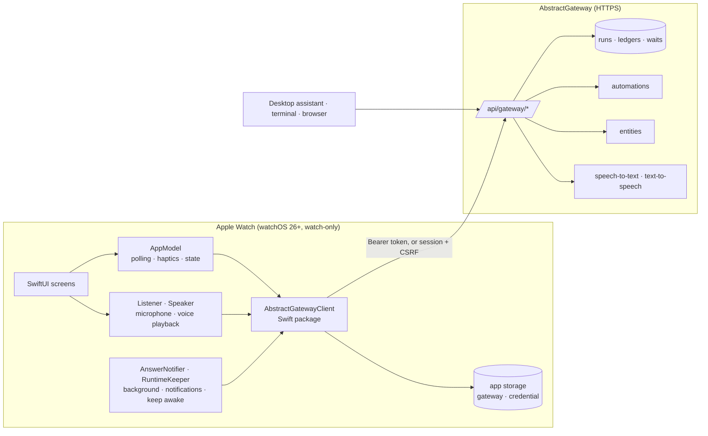

# Architecture: AbstractAssistant for Apple Watch

The watch app follows ADR 0001 of this repository: the gateway is the authority for workflows,
runs, tools, policy and speech; the watch holds a credential and what it shows, and every action it
takes is a gateway request.

A wait answered on the watch is answered for every client; a question asked on the watch is a run
in the same session pool as the desktop assistant's.

## Components

| Component | Responsibility |
|---|---|
| `Sources/App` (SwiftUI) | Screens and navigation (one `NavigationStack`); see [design.md](design.md). |
| `AppModel` (`@MainActor`) | The client, the state on screen (waits, sessions, automations, entities), the 15 s foreground poll, haptics, per-conversation trust. |
| `Listener` | Records 16 kHz mono WAV with metering; detects speech against the room's noise floor; sends after 3 s of silence. |
| `Speaker` | Streams the gateway's voice in chunks and plays them back to back with metering (the orb follows the level); pause, resume, rewind 10 s. |
| `RunProgress` | Follows a running automation down to the agent's child run and describes its newest step in words. |
| `AnswerNotifier` | Hands a run's ledger stream to a background URLSession, posts answers and waits as notifications, background refresh for new waits. |
| `RuntimeKeeper` | An extended runtime session while the app listens, works or speaks, so the voice continues with the wrist down. |
| `AbstractGatewayClient` (SwiftPM) | Typed async client: models, endpoints, markdown and speech text, sign-in; `MockGatewayClient` with the same protocol for previews and screenshots. Tested with `swift test`. |

## Gateway calls behind each screen

| Screen / action | Gateway call |
|---|---|
| Sign in with a token | `GET /api/gateway/me` (must name the account typed) |
| Sign in with an email | `POST /api/gateway/session/recovery/request`, then `POST /api/gateway/session/recovery/redeem` (`remember: true`); the session and CSRF values are sent as `X-AbstractGateway-Session` / `X-AbstractGateway-CSRF` |
| Needs you | `GET /api/gateway/runs?status=waiting`, then `GET /api/gateway/runs/{id}` for each waiting row (the approval lives on the agent's child run) |
| Allow / deny / answer | `POST /api/gateway/commands` `{type: "resume", payload: {wait_key, payload: {approved} or {response}}}`; the run is read again first, and a wait answered elsewhere is not answered twice |
| Accept all (an approval) | allows this conversation's tools on Ask, up to the risk of the call approved (at least "makes changes"); Off tools stay off, sends and tools whose destination the assistant picks keep asking. Allowed tools stay on Ask in the run's `_runtime.tool_policy` (fixed when a run starts); the watch answers their approvals (`POST /api/gateway/commands` resume) while it follows, and only when every call is on Auto or allowed; the shield (or Ask again on the Tools page) clears them, so the next call asks |
| Ask the Assistant | `POST /api/gateway/runs/start` `{flow_id: "@default", interface: "abstractcode.agent.v1", session_id, input_data: {prompt, use_session_history: true, system, tools, _runtime.allowed_tools}}`, then `GET /api/gateway/runs/{id}`; `tools` lists every tool `GET /api/gateway/discovery/tools` reports enabled and available (as the desktop assistant), and `system` is added after the agent's own loop and tool rules |
| Ask an entity | `GET /api/gateway/entities`, `POST /api/gateway/entities/{name}/chat/open`, `POST .../chat/{id}/turn`; the entity row's `appearance` gives its orb |
| Voice in | `POST /api/gateway/attachments/upload` (multipart, `session_id`), `POST /api/gateway/runs/{session owner}/audio/transcribe` |
| Voice out | `POST /api/gateway/runs/{id}/voice/tts/stream` (an entity: `POST /api/gateway/entities/{name}/voice/tts/stream`); the whole text in one request (the gateway speaks it in whole sentences); playback starts once 1.5 s of speech is queued and plays at the speed chosen on the watch |
| Tools | `GET /api/gateway/discovery/tools` (group `toolset`, `description`, `risk_tier`, `enabled`, `approval_default`); each run sends the tools on Auto or Ask as `tools` and `_runtime.allowed_tools`, and `_runtime.tool_policy {auto_approve_tools, require_approval_tools}`; choices are kept on the watch (defaults, then each conversation's changes) |
| Workflow | `GET /api/gateway/bundles?executable_for=abstractcode.agent.v1` and `…=abstractassistant.agent.v1` (newest version per bundle); a chosen one starts as `bundle_id`, `bundle_version`, `flow_id`, `interface`, `registry_scope`; none chosen: `flow_id: "@default"` of `abstractcode.agent.v1`; kept on the watch per conversation (defaults in Settings → Tools) |
| Live work | the root's `GET /api/gateway/runs/{id}` each second, down its `subworkflow:<child>` waits to the run doing the work; that run's `GET /api/gateway/runs/{id}/ledger?after=N`, decoded for `effect.type`, `effect.payload.tool_calls[{name, arguments}]`, `effect.payload.output.modality`, `response_schema`, `result.results[{success, error}]`, `result.content`, `result.wait` only (a thinking record's conversation is skipped); a run that handed off to a child is not read again. About as much data as the run's records (a 90 s agent run with 6 tools: ~3 MB, mostly its thinking records) |
| Media | a finished run's `output` (`outputs.{modality}[].artifact_ref`, `artifact`, `image_artifact`, `audio_artifact`, `video_artifact`); history: `GET /api/gateway/sessions/{id}/artifacts` (`tags.kind == generated_media`, by `run_id` and `parent_run_id`); bytes: `GET /api/gateway/runs/{run}/artifacts/{id}/content` (at most 25 MB), kept in the watch's caches, images shrunk on the watch |
| Sessions | `GET /api/gateway/runs?root_only=true&session_kind=chat,discussion&include_metrics=true`, a row's title is its latest run's prompt from `GET /api/gateway/runs/{id}/input_data` (none is made up); a conversation's history on the orb page: `GET /api/gateway/runs/{newest}/history_bundle?include_session=true&detail=replay` (one request) |
| Cancel / stop | `POST /api/gateway/commands` `{type: "cancel"}` |
| Automations | `GET /api/gateway/automations`; one automation `GET /api/gateway/automations/{id}` (`summary.current_occurrence` while it runs, `definition.target` for its task) |
| Run now / stop / pause / resume | `POST /api/gateway/automations/{id}/commands` `{type: "automation.run_now" \| "automation.stop_current" \| "automation.pause" \| "automation.resume"}` |
| Edit an automation | `PATCH /api/gateway/automations/{id}` `{expected_revision, changes}` with only what changed (`title`, `target`, `trigger`, `context`); a stale revision is refused (409) |
| New automation | `GET /api/gateway/bundles?executable_for=abstractcode.agent.v1` (the workflows offered; the gateway decides), `GET /api/gateway/bundles/{bundle}/flows/{flow}/input_schema?bundle_version=` (a chosen workflow's defaults and required inputs), `POST /api/gateway/automations` `{request_id, title, target, trigger: schedule@2 {kind: every \| daily}, context, policy: {tool_approval}}` — the body the other clients send |
| Earlier runs | `GET /api/gateway/automations/{id}/occurrences?limit=` |
| Live progress | `GET /api/gateway/runs/{id}/ledger?after=` on the occurrence's run and the child runs it starts |
| Seen | `POST /api/gateway/automations/{id}/seen` `{attention_cursor}` |
| Links | the page itself, fetched by the watch and shown as readable text |

## Background and notifications

- **On screen**: waits, sessions and automations every 15 s; a running Ask every second; a running
  automation every 3 s and its steps every 2 s.
- **Answers while away**: each Ask hands `GET /api/gateway/runs/{id}/ledger/stream` to a background
  URLSession. watchOS keeps it open with the app suspended and wakes the app when the gateway
  closes it; the app posts the answer as a notification. Run now does the same for an automation's
  run. No notification is posted for an answer that is on screen.
- **New waits while closed**: a background refresh, about every 15 minutes at the system's
  discretion, posts each new approval or question once. An ordinary tool approval offers Allow
  (the watch must be unlocked) and Deny; a send or a destructive call opens the app.
- **Keep awake**: `WKExtendedRuntimeSession` (`WKBackgroundModes: self-care`, up to 10 minutes)
  from the tap that starts a turn until the voice ends.
- **No push**: the gateway has no push channel; see the backlog track.

## Security

- The watch sends no `user_id` or `tenant_id`: the gateway derives the principal from the
  credential.
- The credential (an account token, or a 30-day session with its CSRF value) is kept in the app's
  storage on the watch (`UserDefaults`), not in a sealed store; Sign out forgets it.
- After a 401 the client sends nothing more (the gateway locks out an address after repeated
  failures) and the app returns to the sign-in screen.
- Transport is HTTPS; plain HTTP is accepted only for local-network addresses (development).
- Nothing else is stored on the watch beyond the choices in Settings.

## Gaps that need gateway work

| Gap | Effect on the watch |
|---|---|
| No device pairing, one token per account | the watch signs in with an account token or an emailed code; rotating the token signs out every client |
| No push channel | waits arrive on the next poll or background refresh, not within a second |
| No risk level in the wait payload | the risk comes from the tool catalog; Double Tap allows only approvals that neither send nor destroy |

## Build and verification

`scripts/build.sh` regenerates the Xcode project with XcodeGen, runs the Swift package tests,
builds the app for the simulator, installs it and captures one screenshot per screen through the
`--screen` launch argument. The `AbstractAssistantWatchUITests` scheme runs UI tests that need a
real tap. See [../BUILD.md](../BUILD.md).
