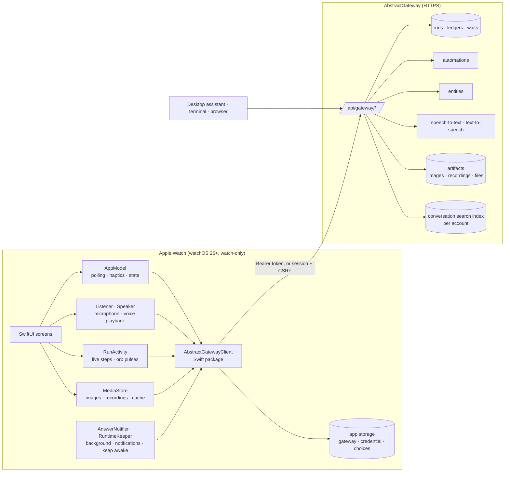
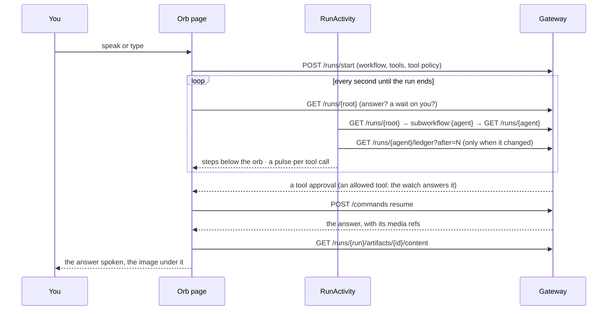

# Architecture: AbstractAssistant for Apple Watch

The watch app follows ADR 0001 of this repository: the gateway is the authority for workflows,
runs, tools, policy and speech; the watch holds a credential and what it shows, and every action it
takes is a gateway request.

A wait answered on the watch is answered for every client; a question asked on the watch is a run
in the same session pool as the desktop assistant's.

### One question, while it works

## Components

| Component | Responsibility |
|---|---|
| `Sources/App` (SwiftUI) | Screens and navigation (one `NavigationStack`); see [design.md](design.md). |
| `AppModel` (`@MainActor`) | The client, the state on screen (waits, sessions, automations, entities), each automation's definition and latest results once read (shared by its pages, updated by a save), the 15 s poll while the scene is active (the automations list at most once a minute; none while the screen is dimmed or the app is in the background), haptics, tool and workflow choices, the tools Accept all allowed, the answers seen on this watch. |
| `Orb`, `OrbScenes`, `OrbConcepts`, `OrbCosmos`, `OrbNature`, `OrbAvatars`, `OrbLines`, `OrbRobots` | The orb (every style drawn from `OrbPhases`, the five phases' weights and the voice): a planet of points whose style answers the voice (Halo, Vortex, Nebula, Liquid, Galaxy), and scenes of their own: Rings, the five state shapes (Lotus, Crystal, Eclipse, Synapse, Drop), Face, Imprint, Contour, Membrane, Eye (one relief of the face, computed once on a grid for the line styles), the six robots, the Cosmos scenes (Well, Black hole, Accretion) and the Nature scenes (Ocean, Aurora, Murmuration); every motion at a fixed pace, the phases blending how much of each shows, so a change of state is always a smooth morph; all frame-rate independent and drawn in one `Canvas`, with the light of its work. |
| `Listener` | Records 16 kHz mono WAV with metering; detects speech against the room's noise floor; sends after 3 s of silence. |
| `Speaker` | Streams the gateway's voice in chunks and plays them back to back with metering (the orb follows the level); pause, resume, rewind 10 s. |
| `RunProgress` | Follows a running automation down to the agent's child run and describes its newest step in words. |
| Browser navigation | `AppModel.path` is the history: a swipe to the right (`goBack`) closes the top page, a swipe to the left (`goForward`) opens again the pages closed by going back (`forward`, kept until something else is opened; only the app's own pages are kept, `Route.revisitable`: a message, its steps, media, a link, a form or a question opens with a tap only); rows and links fire on a tap only (`TapButtonStyle`: a finger that moves is not a tap), and the stack's binding (`stackPath`) also refuses a page opened under a sideways-moving finger, so a swipe across a row never opens it; with nothing ahead, and only from there, the orb page of a conversation with a message opens `ConversationInfoView` (its numbers, and its files from `GET /sessions/{id}/artifacts` and the conversation's folder through `GET /runs/{id}/workspace/files`, each shared as a file downloaded only when shared). |
| `RunActivity` | Follows a question's run down to the run doing the work and reads its new step records (thinking, tool calls, media, waits) into the steps under the orb and the orb's pulses and satellites. |
| `SVGDocument`, `SVGView` | SVG drawn on the watch (it has no web view): the client library reads a drawing into shapes and texts with their transforms, inherited styles, gradients, dashes and blur or drop-shadow filters (rect, circle, ellipse, line, polyline, polygon, every path command with arcs, text, groups); the app draws them in one `Canvas`, fitted with their aspect kept. Not drawn: embedded images, `use`, masks, clip paths, patterns, CSS stylesheets. Used by the file preview (`FilePreviewView`, a vertical pager over the conversation's files) and the media page. |
| `MediaStore` | Downloads an answer's images, recordings and videos from the gateway's artifact route once, keeps them in the watch's caches (150 MB at most) and makes pictures small on the watch. |
| `AnswerNotifier` | Hands a run's ledger stream to a background URLSession once the app leaves the foreground (one per run, ended when the app sees the run end), posts answers and waits as notifications, background refresh for new waits. |
| `RuntimeKeeper` | An extended runtime session while the app listens, works or speaks, so the voice continues with the wrist down. |
| `AbstractGatewayClient` (SwiftPM) | Typed async client: models, endpoints, markdown and speech text, sign-in; reads (GET) that time out, lose their connection or meet a server error are tried 3 times before they fail, writes are sent once ([ADR-0039](https://github.com/lpalbou/AbstractFramework/blob/main/docs/adr/0039-loading-states-spinner-until-a-read-has-failed.md) of AbstractFramework); `MockGatewayClient` with the same protocol for previews and screenshots. Tested with `swift test`. |

## Gateway calls behind each screen

| Screen / action | Gateway call |
|---|---|
| Sign in with a token | `GET /api/gateway/me` (must name the account typed) |
| Sign in with an email | `POST /api/gateway/session/recovery/request`, then `POST /api/gateway/session/recovery/redeem` (`remember: true`); the session and CSRF values are sent as `X-AbstractGateway-Session` / `X-AbstractGateway-CSRF` |
| Needs you | `GET /api/gateway/runs?status=waiting`, then `GET /api/gateway/runs/{id}` for each waiting row (the approval lives on the agent's child run) |
| Allow / deny / answer | `POST /api/gateway/commands` `{type: "resume", payload: {wait_key, payload: {approved} or {response}}}`; the run is read again first, and a wait answered elsewhere is not answered twice |
| Accept all (an approval) | allows this conversation's tools on Ask, up to the risk of the call approved (at least "makes changes"); Off tools stay off, sends and tools whose destination the assistant picks keep asking. Allowed tools stay on Ask in the run's `_runtime.tool_policy` (fixed when a run starts); the watch answers their approvals (`POST /api/gateway/commands` resume) while it follows, and only when every call is on Auto or allowed; the shield (or Ask again on the Tools page) clears them, so the next call asks |
| Ask the Assistant | `POST /api/gateway/runs/start` `{flow_id: "@default", interface: "abstractcode.agent.v1", session_id, input_data: {prompt, use_session_history: true, system, tools, _runtime.allowed_tools}}`, then `GET /api/gateway/runs/{id}`; `tools` lists every tool `GET /api/gateway/discovery/tools` reports enabled and available (as the desktop assistant), and `system` is added after the agent's own loop and tool rules. With the Assistant's workflow (`interface: "abstractassistant.agent.v1"`), the conversation's newest image goes as `primary_image_artifact` (`{$artifact, run_id, content_type}`, also in `context`) with `has_primary_image_context`, as the iPhone and the menu-bar Assistant send it: an edit, an upscale or an image-to-video starts from it |
| Ask an entity | `GET /api/gateway/entities`, `POST /api/gateway/entities/{name}/chat/open`, `POST .../chat/{id}/turn`; the entity row's `appearance` gives its orb |
| Voice in | `POST /api/gateway/attachments/upload` (multipart, `session_id`), `POST /api/gateway/runs/{session owner}/audio/transcribe` |
| Voice out | `POST /api/gateway/runs/{id}/voice/tts/stream` (an entity: `POST /api/gateway/entities/{name}/voice/tts/stream`); the whole text in one request (the gateway speaks it in whole sentences); playback starts once 1.5 s of speech is queued and plays at the speed chosen on the watch |
| Tools | `GET /api/gateway/discovery/tools` (group `toolset`, `description`, `risk_tier`, `enabled`, `approval_default`); each run sends the tools on Auto or Ask as `tools` and `_runtime.allowed_tools`, and `_runtime.tool_policy {auto_approve_tools, require_approval_tools}`; choices are kept on the watch (defaults, then each conversation's changes) |
| Workflow | `GET /api/gateway/bundles?executable_for=abstractcode.agent.v1` and `…=abstractassistant.agent.v1` (newest version per bundle); a chosen one starts as `bundle_id`, `bundle_version`, `flow_id`, `interface`, `registry_scope`; none chosen: `flow_id: "@default"` of `abstractcode.agent.v1`; kept on the watch per conversation (defaults in Settings → Tools) |
| New answers | a conversation is new when its newest turn ended after the watch started counting and is not the turn last seen there (kept on the watch, `sessions.seen`); automations: the gateway's `attention.unseen_count` |
| Automation on/off, archive | `POST /api/gateway/automations/{id}/commands` `{type: "automation.pause" \| "automation.resume" \| "automation.archive" \| "automation.unarchive"}`; `GET /api/gateway/automations?archived_only=true` lists the archived ones; the automations list is read with up to 60 s per request and retried |
| Archive | `POST /api/gateway/sessions/{id}/archive` (and `/unarchive`): out of `GET /runs?root_only=true` on every client, nothing deleted; `GET /api/gateway/runs?archived_only=true&root_only=true` lists them |
| Search | `GET /api/gateway/sessions/search?q=…&limit=25` (AbstractRuntime `ConversationSearch`, the caller's own plane): one item per session with `snippet` and `highlights`; 404 on a gateway without it |
| Live work | the root's `GET /api/gateway/runs/{id}` each second, down its `subworkflow:<child>` waits to the run doing the work; that run's `GET /api/gateway/runs/{id}/ledger?after=N`, decoded for `effect.type`, `effect.payload.tool_calls[{name, arguments}]`, `effect.payload.output.modality`, `response_schema`, `result.results[{success, error}]`, `result.content`, `result.wait` only (a thinking record's conversation is skipped); a run that handed off to a child is not read again. About as much data as the run's records (a 90 s agent run with 6 tools: ~3 MB, mostly its thinking records) |
| Conversation files | `GET /api/gateway/sessions/{id}/artifacts`: `generated_media` and `attachment` rows; an attachment that a transcript (`tags.task == stt`) names as its `source_audio_artifact` is a spoken question, counted apart; a file's bytes come from `GET /api/gateway/runs/{run}/artifacts/{id}/content` when it is shared. The conversation's folder, when the gateway made it for the conversation or the run (`GET /api/gateway/runs/{run}/workspace` `kind` `session` or `run`): `GET /api/gateway/runs/{run}/workspace/files?recursive=true` (hidden files and caches left out; a refused folder lists nothing and leaves the other files shown), each file's bytes from `GET /api/gateway/runs/{run}/workspace/content?path=` |
| Media | a finished run's `output` (`outputs.{modality}[].artifact_ref`, `artifact`, `image_artifact`, `audio_artifact`, `video_artifact`); history: `GET /api/gateway/sessions/{id}/artifacts` (`tags.kind == generated_media`, by `run_id` and `parent_run_id`); bytes: `GET /api/gateway/runs/{run}/artifacts/{id}/content` (at most 25 MB), kept in the watch's caches, images shrunk on the watch |
| Sessions | `GET /api/gateway/runs?root_only=true&session_kind=chat,discussion&include_metrics=true`, a row's title is its latest run's prompt from `GET /api/gateway/runs/{id}/input_data` (none is made up); a conversation's history on the orb page: `GET /api/gateway/runs/{newest}/history_bundle?include_session=true&detail=replay` (one request) |
| Cancel / stop | `POST /api/gateway/commands` `{type: "cancel"}` |
| Automations | `GET /api/gateway/automations`; one automation `GET /api/gateway/automations/{id}` (`summary.current_occurrence` while it runs, `definition.target` for its task) |
| Run now / stop / pause / resume | `POST /api/gateway/automations/{id}/commands` `{type: "automation.run_now" \| "automation.stop_current" \| "automation.pause" \| "automation.resume"}` |
| Edit an automation | `PATCH /api/gateway/automations/{id}` `{expected_revision, changes}` with only what changed (`title`, `target`, `trigger`, `context`); a stale revision is refused (409) |
| New automation | `GET /api/gateway/bundles?executable_for=abstractcode.agent.v1` (the workflows offered; the gateway decides), `GET /api/gateway/bundles/{bundle}/flows/{flow}/input_schema?bundle_version=` (a chosen workflow's defaults and required inputs), `POST /api/gateway/automations` `{request_id, title, target, trigger: schedule@2 {kind: every \| daily}, context, policy: {tool_approval}}` — the body the other clients send |
| Earlier runs | `GET /api/gateway/automations/{id}/occurrences?limit=` |
| Live progress | `GET /api/gateway/runs/{id}/ledger?after=` on the occurrence's run and the child runs it starts |
| Seen | `POST /api/gateway/automations/{id}/seen` `{attention_cursor}` |
| Links | the page itself, fetched by the watch and shown as readable text |

## Background and notifications

- **On screen** (the scene active, someone looking): waits, sessions and automations every 15 s;
  a running Ask every second; a running automation every 3 s and its steps every 2 s. The screen
  dimmed (wrist down, always on): the poll in flight finishes and none follows; the orbs hold
  their last frame; the automations page reads nothing. In the background: nothing.
- **Answers while away**: an Ask left working when the app leaves the foreground hands
  `GET /api/gateway/runs/{id}/ledger/stream` (a keep-alive every 50 s) to a background URLSession,
  once per run. watchOS keeps it open with the app suspended and wakes the app when the gateway
  closes it; the app posts the answer as a notification. A running automation's page does the same
  when the app is left. The stream is ended when the app itself sees the run end or park on a
  person, and given up after an hour (15 minutes a connection, three reconnections). No
  notification is posted for an answer that is on screen.
- **New waits while closed**: a background refresh, about every 15 minutes at the system's
  discretion, reads the waits (one request; the tools' risk tiers only when there is a new one)
  and posts each new approval or question once. An ordinary tool approval offers Allow
  (the watch must be unlocked) and Deny; a send or a destructive call opens the app.
- **Keep awake**: `WKExtendedRuntimeSession` (`WKBackgroundModes: self-care`, up to 10 minutes)
  from the tap that starts a turn until the voice ends, a new conversation is started, or the
  player is dropped; never past the turn. A session about to expire while still held is renewed
  while the app is in front; one that could not start (wrist down) is taken when the app comes
  back in front.
- **The voice plays on**: a reading that is speaking always has something playing. The system can
  stop the player underneath (an audio interruption, the app suspended with the wrist down, the
  keep-awake session gone), and the player's "finished" callback never comes for that: an
  interruption pauses the reading and resumes it when the system allows; the app coming back in
  front plays on from where the voice stopped. Only the voice playing turns the audio session off
  when it ends (an idle player leaving the screen does not).
- **No push**: the gateway has no push channel; see the backlog track.

## Security

- The watch sends no `user_id` or `tenant_id`: the gateway derives the principal from the
  credential.
- The credential (an account token, or a 30-day session with its CSRF value) is kept in the app's
  storage on the watch (`UserDefaults`), not in a sealed store; Sign out forgets it.
- After a 401 the client sends nothing more (the gateway locks out an address after repeated
  failures) and the app returns to the sign-in screen.
- Transport is HTTPS; plain HTTP is accepted only for local-network addresses (development).
- Nothing else is stored on the watch beyond the choices in Settings.

## Gaps that need gateway work

| Gap | Effect on the watch |
|---|---|
| No device pairing, one token per account | the watch signs in with an account token or an emailed code; rotating the token signs out every client |
| No push channel | waits arrive on the next poll or background refresh, not within a second |
| No risk level in the wait payload | the risk comes from the tool catalog; Double Tap allows only approvals that neither send nor destroy |
| No compact view of a run's records | the live steps read the run's full records (a thinking record carries the conversation); reads are skipped when the run has not changed |
| No "seen" state for conversations | new answers are tracked on each watch |

## Build and verification

`scripts/build.sh` regenerates the Xcode project with XcodeGen, runs the Swift package tests,
builds the app for the simulator, installs it and captures one screenshot per screen through the
`--screen` launch argument. The `AbstractAssistantWatchUITests` scheme runs UI tests that need a
real tap. See [../BUILD.md](../BUILD.md).
